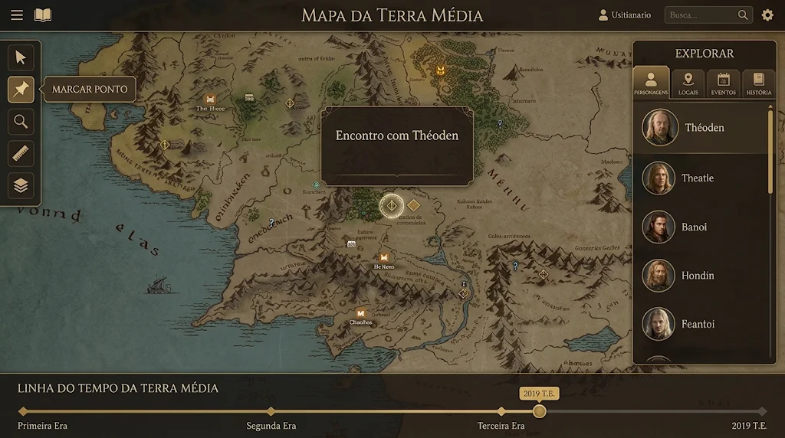

# Worldbuilder's Dream — Atlas vivo para escrita e worldbuilding

Aplicação web de **uso pessoal** (um administrador e, opcionalmente, convidados) para organizar **mapas, personagens, locais, eventos e textos** sobre uma **linha do tempo**. A experiência é inspirada em VTTs (Virtual Tabletops): o mapa ocupa a tela inteira e pode ser movido e ampliado livremente, e personagens, locais e eventos viram **tokens** que se movem conforme o usuário arrasta o **slider do tempo**. Os textos podem ser **Google Docs do próprio usuário**, exibidos e navegáveis dentro do app.

A identidade é a de um **grimório de couro**: o login acontece na capa do livro, o livro se abre na biblioteca de mundos e uma virada de página leva ao mapa.

<p align="center">
  
  &nbsp;
  
</p>

## Documentação

| # | Documento | Conteúdo |
|---|-----------|----------|
| 01 | [Produto](docs/01-produto.md) | Escopo de uso, glossário, jornada do livro, MVP, requisitos |
| 02 | [Arquitetura e back-end](docs/02-arquitetura-e-backend.md) | Visão de sistema, fluxos, ambientes, Supabase, RPCs, Edge Functions, erros |
| 03 | [Código e qualidade](docs/03-codigo-e-qualidade.md) | Pastas, camadas, nomenclatura, testes, Git, CI/CD |
| 04 | [Front-end](docs/04-frontend.md) | Angular, CDK, componentes próprios, rotas do livro, estado, atalhos, textos |
| 05 | [Design](docs/05-design.md) | Referências visuais, paleta, tipografia, transições do livro, animações, área de importação |
| 06 | [Mapa e tempo](docs/06-mapa-e-tempo.md) | Importação de mapa, motor PixiJS, ticks, calendário, keyframes, ferramentas, linha do tempo |
| 07 | [Dados](docs/07-dados.md) | Modelo, DDL de referência, RLS, lista de acesso, migrações |
| 08 | [Google](docs/08-google.md) | Login, Google Docs como texto, Picker, Drive, tokens |
| 09 | [Segurança e operação](docs/09-seguranca-e-operacao.md) | Ameaças, autenticação, CSP, backups, restauração, manutenção |
| 10 | [Roadmap](docs/10-roadmap.md) | Ordem de construção (front primeiro), fases, marcos e riscos |
| 11 | [Guia do administrador](docs/11-guia-do-administrador.md) | Passo a passo: senhas (Bitwarden), contas, Google Cloud, Resend, backup, convites, rotinas e emergências |
| 12 | [Git e branches](docs/12-git-e-branches.md) | Fluxo com Cursor + Claude Code + GitHub Desktop, nomes de branches, commits numerados, plano de branches de todas as fases, uso econômico do Claude Code |
| ADR | [Decisões](docs/adr/README.md) | O porquê de cada escolha |

## Stack

**Angular 22** (standalone, zoneless, signals) · **Angular CDK** · **Tailwind CSS v4** · componentes animados da **Skiper UI** e **Magic UI** portados para Angular · **PixiJS v8** (mapa) · **Tiptap** (texto nativo) · **Google Docs/Drive API + Picker** (texto dos Docs) · **Supabase** gratuito (Postgres, Auth, Storage, Edge Functions, Vault) · **GitHub Actions** (CI e backup diário) · **Cloudflare Pages** · **Vitest + Playwright + pgTAP**.

## Identidade

Couro marrom (`#2b1c12`) · pergaminho bege (`#efe3c8`) · ouro para o que importa (`#d9b25f`) · Cinzel + EB Garamond + Inter. Detalhes em [docs/05](docs/05-design.md).

## Ferramentas de desenvolvimento

**Cursor** com a extensão **Claude Code** (lê o `CLAUDE.md`, que importa o `AGENTS.md`), **Git** instalado no sistema e **GitHub Desktop** para revisar e enviar. Fluxo em [docs/12](docs/12-git-e-branches.md).

## Como começar

```bash
# pré-requisitos: Node >= 24.15, pnpm (corepack enable), Git
pnpm install                   # também instala os hooks do Git (lefthook)
pnpm exec playwright install chromium   # uma vez, para os testes e2e
pnpm start                     # http://localhost:4200
```

A partir da Fase 2 (back-end), também Docker e Supabase CLI:

```bash
supabase start                 # Postgres/Auth/Storage locais
supabase db reset              # aplica as migrações (banco vazio, sem dados de exemplo)
pnpm gen:types                 # tipos TS a partir do schema
```
Variáveis de ambiente: [docs/02 › Ambientes](docs/02-arquitetura-e-backend.md#ambientes-e-configuração).

## Status

Fase de **especificação**, com as decisões principais tomadas. A construção começa pelo **front-end em modo local** (demonstração sem servidor), seguida do back-end e banco, das integrações Google e dos convites ([docs/10](docs/10-roadmap.md)). Quando uma decisão mudar, atualize o documento correspondente e o ADR.

## Pendências

- [ ] Arte final da capa do livro, em camadas (couro, relevo, rosa dos ventos, constelações, fecho, cantoneiras, fita).
- [ ] Logotipo derivado da rosa dos ventos.
- [ ] Domínio (sugestão de identificador: `wbdream`).
- [ ] Seu e-mail como administrador na migração inicial (`private.allowed_emails` e `private.app_admins`).
- [ ] Domínio verificado no Resend para enviar os convites (até lá, usar "Copiar link do convite").
- [ ] Gerenciador de senhas configurado (Bitwarden) — passo a passo em [docs/11](docs/11-guia-do-administrador.md).
- [ ] Definir quem é dono das contas (domínio, Supabase, Google Cloud, Resend, GitHub) e de quem é o e-mail de administrador do app.

## Atribuições

Componentes animados adaptados de [Magic UI](https://magicui.design) (MIT) e [Skiper UI](https://skiper-ui.com) (gratuitos, exigem atribuição). As atribuições ficam no cabeçalho de cada componente portado e em `THIRD_PARTY_NOTICES.md`.
