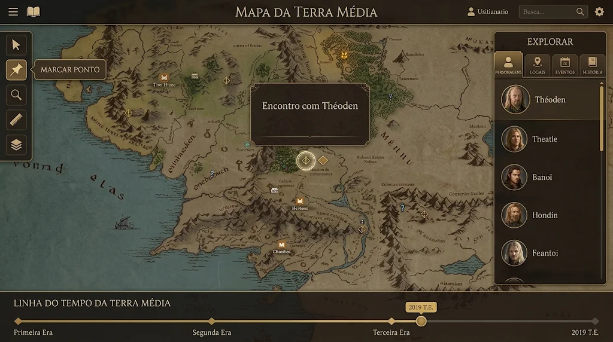

# 01 — Produto

## Problema
Escritores e criadores de mundos espalham o material entre documentos de texto, pastas de imagens, planilhas de cronologia e ferramentas de mapa que não conversam entre si. Responder perguntas simples, como *"onde estava esta personagem no ano 312?"* ou *"quem passou por esta cidade antes da guerra?"*, exige reconstruir tudo de cabeça.

## Proposta
Um **atlas vivo** em forma de livro. O mapa é a tela principal e o tempo é uma dimensão navegável: ao arrastar o slider da linha do tempo, tokens de personagens, locais e eventos aparecem, desaparecem e se deslocam pelo mapa. Cada token abre a ficha da entidade, cujo texto pode ser nativo ou **um Google Doc do próprio usuário**, exibido e navegável dentro do app.

## Escopo de uso
- **Uso pessoal**: começa com **um único usuário, o administrador** (o autor), e pode crescer para poucas pessoas convidadas.
- **Acesso por convite**: o login é feito **apenas com Google** e só entram e-mails autorizados. O administrador **convida por e-mail**; quem recebe confirma pelo link do convite e entra com a conta Google daquele e-mail. Não há cadastro público, planos ou pagamento.
- O app **começa vazio**: não traz mundos, mapas, personagens nem dados de exemplo.
- Idioma da interface: **pt-BR**.

## Glossário
| Termo | Significado |
|-------|-------------|
| **Mundo** (*world*) | Projeto raiz. Contém mapas, entidades, eventos, calendário e membros. |
| **Entidade** (*entity*) | Personagem, local, facção, item ou nota. Tem ficha e pode virar token. |
| **Evento** (*event*) | Algo que acontece num intervalo de tempo, opcionalmente num lugar, envolvendo entidades. |
| **Mapa** (*map*) | Imagem com escala opcional; pode ter mapas-filhos (mundo → região → cidade). |
| **Token** | Representação de uma entidade ou evento posicionada num mapa. |
| **Keyframe** | Posição/estado de um token num instante. Entre keyframes o motor interpola. |
| **Anotação** | Pino, traço, região, rótulo ou medição desenhada no mapa, com validade temporal opcional. |
| **Tick** | Unidade atômica de tempo do mundo (um minuto do mundo). Ver `docs/06`. |
| **Calendário** | Regras que convertem ticks em datas legíveis (meses, eras, dias por ano). |
| **Texto principal** | O texto de um mundo, entidade ou evento: nativo (editado no app) ou um Google Doc vinculado. |

## Jornada principal (metáfora do livro)
1. **Capa**: um livro de couro fechado. Na placa de pergaminho sob a rosa dos ventos, o botão **Entrar com Google**.
2. **O livro se abre**: o fecho se solta e a capa gira, revelando a **biblioteca de mundos** (sumário à esquerda, frontispício do mundo à direita).
3. **Virada de página**: ao escolher um mundo, a página vira e o mapa se expande até ocupar a tela. Um mundo sem mapa abre na **área de importação**: basta arrastar a imagem.
4. **De volta ao livro**: o ícone de livro na barra superior faz o caminho inverso.

Visual e regras de animação: [`docs/05` › Transições do livro](05-design.md#transições-do-livro).

## Layout da tela principal (estilo VTT)


```
┌──────────────────────────────────────────────────────────────────┐
│ ☰ 📖        MAPA DE <NOME DO MAPA> ▾        usuário · busca · ⚙  │
├────┬───────────────────────────────────────────────────┬─────────┤
│ F  │                                                   │EXPLORAR │
│ e  │                                                   │ Person. │
│ r  │             MAPA (canvas em tela cheia,           │ Locais  │
│ r  │          pan/zoom independente das barras)        │ Eventos │
│ a  │                                                   │ História│
│ m. │                                                   │ (lista  │
│    │                                                   │ arrastá-│
│    │                                                   │ vel)    │
├────┴───────────────────────────────────────────────────┴─────────┤
│ LINHA DO TEMPO DE …  ◆ 1ª Era ── ◆ 2ª Era ──●(312 EC)──── fim ◆  │
└──────────────────────────────────────────────────────────────────┘
```
As barras **flutuam sobre** o canvas e são recolhíveis; o mapa sempre ocupa a viewport inteira, então recolher uma barra nunca redimensiona ou move o mapa.

## Escopo do MVP
### Incluído
1. Login com Google na capa do livro, restrito aos e-mails autorizados (inicialmente só o administrador).
2. Biblioteca de mundos: criar, renomear, duplicar, arquivar, lixeira e exportar (JSON).
3. **Importar mapa arrastando uma imagem** para a tela (ou escolhendo o arquivo); escala opcional; hierarquia simples de mapas.
4. Entidades (personagem, local, facção, item, nota) com retrato e texto principal nativo ou Google Doc.
5. Eventos com início/fim, local e participantes.
6. Calendário configurável (meses, dias, eras), com um padrão gregoriano simplificado.
7. Canvas com pan/zoom, tokens, pinos, régua, pincel, regiões e rótulos.
8. Arrastar entidades/eventos da barra direita para o mapa, criando token com keyframe no instante atual.
9. Linha do tempo com eras, marcadores de eventos, reprodução (play) e velocidade.
10. **Google Docs como texto do site**: Docs exibidos dentro do app, com nomes de entidades como links e datas que movem a linha do tempo; edição no Google Docs; aba **História** com os Docs do mundo.
11. **Convites por e-mail**: o administrador convida, o convidado aceita pelo link e entra com Google; o administrador pode reenviar, cancelar convites e revogar acessos. Convidados podem receber acesso de editor a mundos escolhidos.
12. Backup diário automático (operação, ver `docs/09`).

### Fora do MVP (ver `docs/10`)
Tempo real e presença entre os usuários de um mundo, leitura offline, edição leve de Docs dentro do app, mapas gigantes com tiles, rotas que seguem caminhos, árvore genealógica, exportação PDF/EPUB, edição no celular.

## Requisitos funcionais
| ID | Requisito |
|----|-----------|
| RF-01 | Login apenas com Google; e-mails fora da lista de autorizados veem uma mensagem e nenhuma conta é criada. |
| RF-01a | O administrador envia convites por e-mail (opcionalmente com acesso de editor a mundos escolhidos); o convite vale 7 dias e só pode ser usado uma vez. |
| RF-01b | O convidado abre o link, aceita e entra com a conta Google **do e-mail convidado**; com outra conta, o acesso é recusado com uma mensagem clara. |
| RF-01c | O administrador vê pessoas com acesso e convites pendentes, reenvia ou cancela convites e revoga acessos. |
| RF-02 | Usuário cria, renomeia, duplica, arquiva, envia para a lixeira, restaura e exclui mundos. |
| RF-03 | O mapa pode ser movido (arrastar, botão do meio, espaço+arrastar) e ampliado (roda, pinça) sem afetar as barras. |
| RF-04 | Barras esquerda, direita e inferior são recolhíveis; o estado persiste por usuário. |
| RF-05 | Arrastar item da barra direita para o mapa cria token no ponto solto, no instante atual da linha do tempo. |
| RF-06 | Mover um token no instante T cria ou atualiza o keyframe em T. |
| RF-07 | Ao mover o slider, os tokens refletem a posição interpolada para o instante. |
| RF-08 | A régua mede distâncias usando a escala do mapa (ou pixels, sem escala definida). |
| RF-09 | Pincel e regiões desenham anotações vetoriais com validade temporal opcional. |
| RF-10 | Mundo sem mapa mostra apenas a área de importação; soltar uma imagem em qualquer ponto da janela cria o mapa. |
| RF-11 | O texto principal de mundo, entidade ou evento pode ser nativo ou um Google Doc, exibido no app com nomes de entidades como links e datas como âncoras de tempo. |
| RF-12 | A aba História lista e ordena os Google Docs vinculados ao mundo. |
| RF-13 | Busca global por nome e texto em entidades, eventos e Docs em cache. |
| RF-14 | Transições do livro (capa → biblioteca → mapa e volta) podem ser puladas; são sempre completas, com fade cruzado para quem pede movimento reduzido no sistema e versão curta automática em máquinas lentas (ADR-0011). |
| RF-15 | O dono de um mundo adiciona ou remove, como editor, pessoas que já têm acesso ao app. |
| RF-16 | Usuário exporta um mundo (JSON) e exclui a própria conta. |
| RF-17 | Um mapa pode ter versões da imagem a partir de datas do mundo (antes e depois de um cataclismo, uma cidade que cresce); ao mover o slider, o mapa mostra a versão daquele instante, sem perder tokens, anotações e links. |

## Requisitos não funcionais
| ID | Requisito | Meta |
|----|-----------|------|
| RNF-01 | Desempenho do canvas | 60 fps com 300 tokens visíveis em hardware médio |
| RNF-02 | Atualização do slider | posições recalculadas em < 8 ms por quadro |
| RNF-03 | Carregamento | capa interativa em < 2,5 s em banda larga; bundle inicial < 300 kB gzip |
| RNF-04 | Transições do livro | ≥ 50 fps; nunca bloqueiam a interação por mais de 1,5 s |
| RNF-05 | Acessibilidade | WCAG 2.2 AA nas telas fora do canvas; atalhos de teclado no canvas |
| RNF-06 | Segurança | RLS em 100% das tabelas; acesso só para e-mails autorizados |
| RNF-07 | Durabilidade | backup diário (perda máxima de 24 h); restauração testada a cada trimestre |
| RNF-08 | Navegadores | duas últimas versões de Chrome, Edge, Firefox e Safari; desktop primeiro, tablet suportado |
