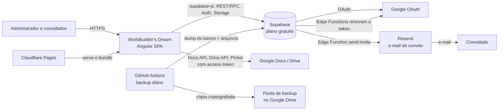
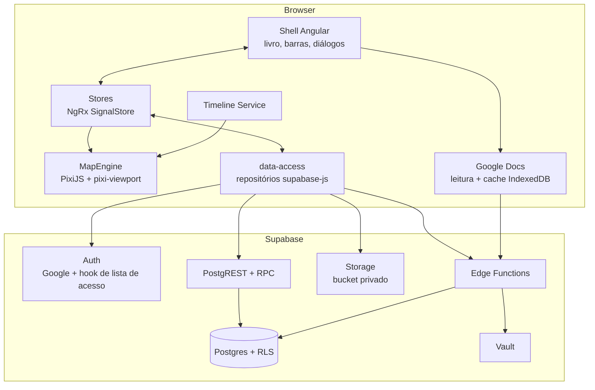

# 02 — Arquitetura e back-end

## Princípios
1. **Front-end rico, back-end gerenciado.** A interação vive no navegador; o **Supabase** (plano gratuito) fornece banco, autenticação, arquivos e funções. Não há servidor próprio. Ver [ADR-0005](adr/0005-supabase-gratuito-com-backup-diario.md).
2. **Segurança no banco, não no cliente.** A URL e a chave publicável do Supabase ficam visíveis no navegador; toda autorização é imposta por **Row Level Security (RLS)**.
3. **Acesso fechado, por convite.** Login só com Google e apenas para e-mails autorizados; novos e-mails entram por convite do administrador. Ver [ADR-0013](adr/0013-login-google-e-acesso-fechado.md).
4. **Motor do mapa isolado.** O canvas (PixiJS) fica atrás de uma fachada, sem conhecer Angular. Ver [ADR-0004](adr/0004-pixijs-como-motor-do-mapa.md).
5. **O texto do usuário pode morar no Google Docs.** O app guarda referências e cache; o Doc é a fonte da verdade. Ver [ADR-0008](adr/0008-google-docs-como-fonte-do-texto.md).
6. **Não perder dados.** Backup diário automático fora do Supabase, criptografado. Ver `docs/09`.
7. **Simples de operar.** Dois ambientes (local e produção), deploy a cada merge e nenhuma peça que exija atenção diária.

## Visão de contexto


## Visão de contêineres


| Contêiner | Responsabilidade | Não faz |
|-----------|------------------|---------|
| Shell Angular | Livro (capa, biblioteca), barras, painéis, formulários, diálogos, atalhos | Renderizar o mapa |
| Stores | Estado do mundo, seleção, ferramenta ativa, tempo atual, desfazer/refazer | Chamar Pixi diretamente |
| MapEngine | Mapa, tokens, anotações, câmera, hit-test, eventos de interação | Conhecer Supabase ou Angular |
| Timeline Service | Tempo atual (signal), reprodução, conversão tick ⇄ data | Persistir dados |
| Google Docs | Ler Docs, converter para Tiptap, cache, detectar nomes e datas | Guardar tokens de longa duração |
| data-access | Repositórios tipados (implementam as portas do `domain/`), mapeamento, erros | Regras de UI |
| PostgREST/RPC | CRUD e operações transacionais | — |
| Edge Functions | Token do Google, processamento de imagens, exportação, exclusão de conta | CRUD comum |

## Fluxos principais

### 1. Entrar
1. Capa → **Entrar com Google** → `supabase.auth.signInWithOAuth({ provider: 'google', … })` com escopo `drive.file` e acesso offline.
2. O hook *before user created* do Supabase consulta a lista de e-mails autorizados; quem não está nela é recusado sem criar conta.
3. No retorno, o app envia o *refresh token* do Google à Edge Function `google-connect` (guardado no Vault) e o descarta.
4. Livro abre → `/biblioteca`.

### 1a. Convidar alguém
```mermaid
sequenceDiagram
  participant A as Administrador
  participant App as App
  participant EF as Edge Functions
  participant DB as Postgres (private)
  participant R as Resend
  participant C as Convidado
  participant SA as Supabase Auth + hook

  A->>App: Configurações › Pessoas › Convidar (e-mail, mundos)
  App->>EF: send-invite
  EF->>DB: cria convite (só o hash do token), validade 7 dias
  EF->>R: envia e-mail com link /convite#token
  R-->>C: "Você foi convidado…"
  C->>App: abre o link (capa em modo convite)
  App->>EF: check-invite(token) → válido, para qual e-mail
  C->>App: Aceitar e entrar com Google
  App->>EF: accept-invite(token)
  EF->>DB: e-mail entra na lista de acesso; mundos ficam pendentes; convite usado
  App->>SA: signInWithOAuth(google, login_hint = e-mail convidado)
  SA->>DB: hook confere a lista → conta criada
  DB->>DB: trigger converte mundos pendentes em world_members
```
- O token vai no **fragmento** da URL (`#`), que o navegador não envia a servidores nem em `Referer`.
- "Confirmar" o convite exige duas coisas: ter o link **e** entrar com a conta Google daquele e-mail. Um link interceptado não serve para outra conta.
- Se o e-mail já tem acesso, `send-invite` só adiciona os mundos e envia um aviso.

### 2. Abrir um mundo
1. Na biblioteca, **Abrir mundo** dispara a virada de página **e**, em paralelo, `WorldStore.load(worldId)`: mundo + calendário, mapas, entidades e eventos (campos de lista).
2. Mapa ativo → RPC `get_map_scene` (tokens, keyframes, anotações).
3. `MapEngine.loadScene()`; `TimelineService.currentTick` dirige a renderização.
4. Sem mapa → área de importação (`docs/06` §0).

### 3. Importar mapa
Imagem solta na janela → validação e conversão para WebP num Web Worker → cena exibida na hora a partir do bitmap local → registro `maps` criado de forma otimista → envio ao Storage em segundo plano, com retentativa. Detalhes em `docs/06`.

### 4. Arrastar personagem para o mapa
1. Item da barra direita (`cdkDrag`) é solto sobre o canvas; `MapEngine.screenToWorld()` converte a posição.
2. `MapStore.placeToken()` aplica a mudança de forma otimista e registra o comando no histórico de desfazer.
3. RPC `place_token` (token + keyframe numa transação). Em erro, a store reverte e avisa.

### 5. Mover o slider
`TimelineService.currentTick.set(t)` → o motor, no próximo quadro, faz busca binária e interpolação nos keyframes já carregados. Nenhuma chamada de rede e nenhuma atualização de template por quadro.

### 6. Ler um Google Doc
`GoogleTokenService` pede um access token à Edge Function `google-token` (válido por até 1 h, só em memória) → `documents.get` → conversor para Tiptap → cache por `revisionId`. Detalhes em `docs/08`.

## Decisões de arquitetura
| Tema | Decisão | ADR |
|------|---------|-----|
| Framework | Angular 22, standalone, zoneless, signals | [0001](adr/0001-angular-standalone-zoneless-signals.md) |
| UI | Angular CDK + Tailwind v4 (sem Angular Material) | [0002](adr/0002-cdk-e-tailwind-sem-material.md) |
| Animações | Skiper UI + Magic UI portados para Angular | [0003](adr/0003-skiper-ui-e-magic-ui-portados-para-angular.md) |
| Mapa | PixiJS v8 + pixi-viewport | [0004](adr/0004-pixijs-como-motor-do-mapa.md) |
| Back-end | Supabase gratuito + backup diário | [0005](adr/0005-supabase-gratuito-com-backup-diario.md) |
| Tempo | Ticks inteiros + calendário + keyframes | [0006](adr/0006-modelo-temporal-ticks-e-keyframes.md) |
| Imagens | Storage do Supabase por padrão, Drive opcional | [0007](adr/0007-armazenamento-de-imagens.md) |
| Texto | Google Docs como fonte do texto; token no servidor | [0008](adr/0008-google-docs-como-fonte-do-texto.md) |
| Estado | NgRx SignalStore | [0009](adr/0009-ngrx-signalstore-para-estado.md) |
| Texto nativo | Tiptap (JSON) | [0010](adr/0010-tiptap-como-editor.md) |
| Navegação | Livro: capa → biblioteca → mapa | [0011](adr/0011-navegacao-como-livro.md) |
| Identidade | Couro, pergaminho e ouro | [0012](adr/0012-identidade-visual-couro-pergaminho-ouro.md) |
| Acesso | Só Google, lista fechada de e-mails | [0013](adr/0013-login-google-e-acesso-fechado.md) |

## Ambientes e configuração
| Ambiente | Front | Supabase | Uso |
|----------|-------|----------|-----|
| `local` | `ng serve` (`dataSource: 'local'` ou `'supabase'`) | `supabase start` (Docker), banco vazio | Desenvolvimento e testes |
| `production` | Cloudflare Pages (domínio próprio) | projeto `wbdream` (plano gratuito, região `sa-east-1`) | Uso real |

Não há demo publicada: nas Fases 0–1, o cliente acompanha o progresso por **vídeos de tela** do app rodando localmente em modo local (`dataSource: 'local'`, dados no IndexedDB, login simulado).

A ordem de construção (front primeiro, com adaptadores locais) está em [`docs/10`](10-roadmap.md). Não há staging nem deploys de preview: com poucos usuários, os testes locais (incluindo pgTAP e e2e contra o Supabase local) cumprem esse papel.

**Variáveis públicas do front** (entram no bundle; nunca segredos):
```
NG_APP_SUPABASE_URL=
NG_APP_SUPABASE_PUBLISHABLE_KEY=     # pública por natureza; o RLS protege os dados
NG_APP_GOOGLE_CLIENT_ID=
NG_APP_GOOGLE_API_KEY=               # restrita por referrer HTTP e só à Picker API
NG_APP_GOOGLE_APP_ID=                # número do projeto Google Cloud (Picker)
```
**Segredos** (só em Supabase Secrets e GitHub Secrets): `SUPABASE_SERVICE_ROLE_KEY`, `GOOGLE_CLIENT_SECRET`, `RESEND_API_KEY`, `INVITE_FROM` (ex.: `Worldbuilder's Dream <convites@seudominio>`), `APP_URL`, `SUPABASE_DB_URL` (backup), `RCLONE_CONFIG` (backup). As senhas originais da criptografia dos backups ficam no gerenciador de senhas (`docs/09`).

## Hospedagem
- **Front**: Cloudflare Pages (gratuito), com `_headers` para CSP e headers de segurança e fallback de SPA.
- **Supabase**: região `sa-east-1` (São Paulo).
- Não há páginas públicas: a capa do livro é a única tela sem sessão.

---

# Back-end (Supabase)

## Serviços usados
| Serviço | Uso |
|---------|-----|
| **Postgres** | Dados, integridade, RLS, funções (RPC), busca de texto |
| **PostgREST** (`supabase-js`) | CRUD com filtros e `select` aninhado |
| **RPC** (funções SQL) | Operações transacionais ou com várias tabelas |
| **Auth** | Login com Google (PKCE) e hook de lista de acesso. O e-mail padrão do Supabase não é usado (ele só entrega para membros da equipe do projeto, 2 por hora) |
| **Resend** (externo) | Envio dos e-mails de convite, a partir de um domínio próprio verificado |
| **Storage** | Imagens de mapas e retratos, bucket **privado** |
| **Edge Functions** (Deno) | Token do Google, processamento de imagens, exportação, exclusão de conta |
| **Vault** | Refresh tokens do Google, criptografados |
| **Realtime** | Fase 5 (evolução): alterações ao vivo e presença entre os usuários de um mundo |

## Quando usar cada mecanismo
| Caso | Mecanismo | Exemplo |
|------|-----------|---------|
| Ler/editar uma tabela, RLS suficiente | PostgREST | listar entidades; renomear entidade |
| Escrever em várias tabelas atomicamente | RPC `security invoker` | `place_token` (token + keyframe) |
| Consultas de leitura específicas | RPC `stable` | `get_map_scene`, `search_world` |
| Privilégio controlado | RPC `security definer` com checagens explícitas | `create_world`, `add_world_member` |
| Segredo, rede externa ou CPU | Edge Function | `google-token`, `export-world` |

`security definer` sempre com `set search_path = ''`, nomes qualificados, `revoke … from public, anon` e verificação de `auth.uid()` e do papel no início da função.

## Cliente e repositórios
```ts
// core/supabase/supabase.client.ts
export function createSupabaseClient() {
  return createClient<Database>(env.supabaseUrl, env.supabasePublishableKey, {
    auth: { flowType: 'pkce', persistSession: true, autoRefreshToken: true, detectSessionInUrl: true },
  });
}
```
- `Database` vem de `pnpm gen:types` e é versionado em `core/supabase/database.types.ts`.
- **Portas e adaptadores**: o `domain/` declara interfaces (`WorldRepository`, `MapRepository`, `EntityRepository`, …); `data-access/` implementa com supabase-js. Trocar de back-end no futuro fica restrito a essa camada.
- Só `data-access/` chama o cliente do Supabase.

```ts
@Injectable({ providedIn: 'root' })
export class SupabaseEntityRepository implements EntityRepository {
  private sb = inject(SUPABASE_CLIENT);

  async list(worldId: string): Promise<EntitySummary[]> {
    const { data, error } = await this.sb.from('entities')
      .select('id, kind, name, subtitle, aliases, color, portrait_asset_id, updated_at')
      .eq('world_id', worldId).is('deleted_at', null).order('name');
    if (error) throw toAppError(error);
    return data.map(toEntitySummary);
  }

  async update(id: string, patch: EntityPatch, expectedVersion: number) {
    const { data, error } = await this.sb.from('entities')
      .update(toEntityRow(patch)).eq('id', id).eq('version', expectedVersion)
      .select('id, version').maybeSingle();
    if (error) throw toAppError(error);
    if (!data) throw new AppError('conflict');   // o outro usuário editou antes
    return data;
  }
}
```
- Colunas sempre explícitas (nunca `select('*')`).
- Validação com **zod** nos formulários e nas Edge Functions; `CHECK constraints` como última barreira.

## Contratos de RPC (MVP)
| Função | Tipo | Descrição |
|--------|------|-----------|
| `create_world(p_name, p_description, p_calendar)` | definer | Cria mundo, membro `owner` e calendário padrão |
| `duplicate_world(p_world_id, p_name)` | definer | Cópia profunda (referencia os mesmos arquivos do Storage) |
| `add_world_member(p_world_id, p_email)` | definer | Só o dono; o e-mail precisa ser de alguém que já tem acesso ao app (para quem ainda não tem, usar convite) |
| `is_app_admin()` | definer, stable | Diz se o usuário atual é administrador do app (usado pela UI e pelas Edge Functions) |
| `remove_world_member(p_world_id, p_user_id)` | definer | Só o dono; nunca remove o último `owner` |
| `get_map_scene(p_map_id, p_t_from, p_t_to)` | invoker, stable | Mapa + tokens + keyframes (janela opcional) + anotações em uma ida |
| `place_token(p_map_id, p_entity_id, p_tick, p_x, p_y)` | invoker | Cria token se preciso e faz upsert do keyframe |
| `upsert_keyframe(p_token_id, p_tick, p_x, p_y, p_visible, p_interp)` | invoker | Upsert por `(token_id, tick)` |
| `search_world(p_world_id, p_query, p_limit)` | invoker, stable | Busca de texto (`websearch_to_tsquery`) em entidades e eventos |
| `world_timeline_markers(p_world_id, p_t_from, p_t_to)` | invoker, stable | Eventos e intervalos para a régua da linha do tempo |
| `empty_trash(p_world_id)` | invoker | Exclui definitivamente o que está na lixeira |

Convenções: parâmetros com prefixo `p_`; erros com `raise exception using errcode = 'P0001', message = 'conflict'` (mapeados para `AppError`); toda RPC tem teste pgTAP (dono pode, estranho não pode, entrada inválida falha).

## Edge Functions
Base comum em `supabase/functions/_shared/`: CORS restrito à origem do app, verificação do JWT, validação zod, erros em *problem+json* sem stack trace, logs sem tokens nem conteúdo.

| Função | Descrição | Proteções |
|--------|-----------|-----------|
| `send-invite` | Cria convite (token aleatório de 32 bytes; guarda só o SHA-256), envia o e-mail pelo Resend e devolve o link uma única vez (botão "Copiar link") | JWT; **só administrador**; até 10 convites por dia |
| `check-invite` | Diz se um token é válido e para qual e-mail e mundos (para a capa em modo convite) | sem JWT; rate limit por IP; resposta genérica para token inválido |
| `accept-invite` | Valida o token, põe o e-mail na lista de acesso, registra os mundos pendentes e marca o convite como usado (transação) | sem JWT; token de uso único; rate limit por IP |
| `revoke-access` | Remove o e-mail da lista, bloqueia a conta (ban), remove de mundos, revoga e apaga o token do Google da pessoa | JWT; só administrador; nunca a si mesmo |
| `google-connect` | Recebe o refresh token do Google após o login e guarda criptografado no Vault | JWT; nunca devolve o token |
| `google-token` | Devolve access token do Google (≤ 1 h), renovando com o refresh token guardado | JWT; rate limit simples por usuário; `Cache-Control: no-store` |
| `google-disconnect` | Revoga o acesso no Google e apaga o refresh token | JWT |
| `process-asset` | Revalida a imagem enviada (assinatura real do arquivo, dimensões), gera miniatura e registra `size_bytes` | JWT; editor do mundo; limite de tamanho |
| `export-world` | Gera o JSON completo do mundo + manifesto de imagens com URLs assinadas por 24 h | JWT; membro do mundo |
| `delete-account` | Apaga dados, arquivos e a conta Auth | JWT com login recente (< 10 min); confirmação por texto |

O front já redimensiona e converte imagens para WebP antes do envio; `process-asset` é a validação no servidor.

## Storage
| Bucket | Privado | Caminho | Limite | Tipos |
|--------|---------|---------|--------|-------|
| `world-assets` | sim | `{world_id}/{asset_id}/{variant}.webp` | 20 MB | `image/webp`, `image/png`, `image/jpeg` |

- Leitura por **URLs assinadas** de 1 h, renovadas pelo front antes de expirar.
- Políticas reutilizam `can_read_world()`/`can_edit_world()` a partir do primeiro segmento do caminho.
- Capacidade do plano gratuito (≈ 1 GB) comporta centenas de mapas em WebP.

## Realtime (Fase 5, evolução)
Canal por mundo (`world:{id}`) com Postgres Changes em `entities`, `events`, `map_tokens`, `token_keyframes` e `map_annotations`, mais Presence (quem está em qual mapa e instante). Ecos das próprias alterações são ignorados via `client_mutation_id`.

## Erros
| `AppError.code` | Origem típica | UI |
|-----------------|---------------|----|
| `unauthenticated` | JWT expirado | volta à capa, preservando a rota |
| `not_allowed` | e-mail fora da lista de acesso | mensagem na capa: "Este e-mail não tem acesso a este livro" |
| `invite_invalid` | token inexistente, usado, cancelado ou expirado | capa: "Este convite não é mais válido. Peça um novo a quem convidou você." |
| `wrong_account` | convite aceito, mas login com outra conta Google | capa: "Este convite é para <e-mail>. Entre com essa conta Google." |
| `forbidden` | RLS / `42501` | "Você não tem acesso a este mundo." |
| `not_found` | `PGRST116` | estado vazio |
| `conflict` | versão divergente, `23505` | recarrega o item e avisa |
| `validation` | `23514`, `22P02`, zod | mensagem no campo |
| `google_unavailable` | token do Google revogado/expirado | "Reconectar Google" |
| `paused` | projeto Supabase em pausa | "O servidor está em pausa; tente em alguns minutos" (ver `docs/09`) |
| `network` | falha de rede | tentar novamente |

## Limites técnicos
Sem planos nem cotas comerciais; os limites só protegem desempenho e o armazenamento gratuito:

| Recurso | Limite |
|---------|--------|
| Imagem de mapa (após conversão) | 8192 px no lado maior; 20 MB |
| Retrato | 1024 px; 2 MB |
| Texto nativo de uma ficha | 500 mil caracteres |

## Evolução da API
A "API" é o schema do banco. Mudanças incompatíveis seguem **expandir → migrar → contrair** em migrações separadas.
