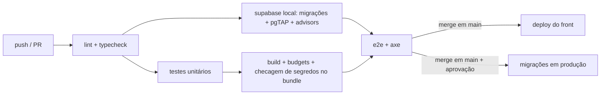

# 03 — Código e qualidade

## Repositório
Um único repositório **privado** no GitHub, com o app Angular e a pasta do Supabase. Gerenciador de pacotes: **pnpm**.

```
worldbuilders-dream/
├── AGENTS.md
├── README.md
├── THIRD_PARTY_NOTICES.md        # atribuições (Skiper UI, Magic UI, fontes, bibliotecas)
├── docs/                         # esta documentação + ADRs
├── src/
│   ├── main.ts
│   ├── index.html
│   ├── assets/
│   │   ├── fonts/                # Cinzel, EB Garamond, Inter, JetBrains Mono (auto-hospedadas)
│   │   ├── book/                 # camadas da capa (couro, relevo, rosa dos ventos, fecho…)
│   │   ├── textures/             # couro e pergaminho (WebP/AVIF em mosaico)
│   │   └── icons/                # SVGs próprios (ferramentas, tipos de token)
│   ├── styles/                   # só CSS (sem Sass)
│   │   ├── styles.css            # entrada: @import "tailwindcss"; @theme; camadas
│   │   ├── palette.css           # primitivos couro / pergaminho / ouro
│   │   ├── tokens.css            # semânticos --wd-*
│   │   ├── fonts.css             # @font-face das fontes auto-hospedadas
│   │   └── textures.css          # texturas e filetes
│   └── app/
│       ├── app.config.ts
│       ├── app.routes.ts
│       ├── core/                 # singletons transversais
│       │   ├── auth/             # AuthService, guards, sessão
│       │   ├── supabase/         # cliente, tipos gerados, mapeamento de erros
│       │   ├── google/           # token, Picker, Docs, Drive
│       │   ├── error/            # ErrorHandler global
│       │   └── strings/          # textos da interface em pt-BR (constantes)
│       ├── shared/
│       │   ├── ui/               # componentes visuais próprios sobre o CDK (botão, diálogo, menu, abas…)
│       │   ├── motion/           # BookAnimator + componentes animados portados
│       │   ├── directives/
│       │   ├── pipes/
│       │   └── utils/
│       ├── domain/               # TS puro, 100% testável
│       │   ├── calendar/         # tick ⇄ data, formatação
│       │   ├── timeline/         # interpolação, busca de keyframes
│       │   ├── geometry/         # distância, escala, conversões
│       │   ├── gdocs/            # Google Doc (JSON) → Tiptap, detecção de nomes e datas
│       │   ├── ports/            # interfaces de repositório (WorldRepository…)
│       │   └── models/
│       ├── data-access/          # implementações das portas
│       │   ├── local/            # IndexedDB + FakeAuthService (modo demonstração, Fases 0–1; depois, cache offline)
│       │   └── supabase/         # Supabase (Fase 2 em diante)
│       ├── map-engine/           # PixiJS — NÃO importa @angular/*
│       │   ├── map-engine.ts     # fachada pública
│       │   ├── layers/
│       │   ├── tools/            # pan, select, pin, ruler, brush, region, label
│       │   ├── import/           # worker de decodificação/conversão de imagem
│       │   └── render/
│       └── features/             # telas (lazy loaded)
│           ├── book/             # BookShell (livro 3D persistente)
│           │   ├── cover/        # capa = login com Google
│           │   └── library/      # livro aberto = sumário + frontispício
│           ├── world/            # o "VTT"
│           │   ├── shell/        # barras flutuantes
│           │   ├── canvas/       # host do MapEngine, área de importação, drop de tokens
│           │   ├── toolbar-left/
│           │   ├── explorer/     # abas Personagens, Locais, Eventos, História
│           │   ├── timeline-bar/
│           │   ├── entity-sheet/ # ficha (texto nativo ou Google Doc)
│           │   ├── event-editor/
│           │   ├── map-settings/
│           │   └── state/        # WorldStore, MapStore, TimelineStore, ToolStore, HistoryStore
│           └── settings/         # conta, Google, aparência, membros, lixeira, exportar
├── supabase/
│   ├── config.toml
│   ├── migrations/               # YYYYMMDDHHMMSS_descricao.sql
│   ├── tests/                    # pgTAP: *.test.sql (criam e descartam os próprios dados)
│   └── functions/
│       ├── _shared/
│       ├── send-invite/  check-invite/  accept-invite/  revoke-access/
│       ├── google-connect/  google-token/  google-disconnect/
│       ├── process-asset/  export-world/  delete-account/
├── e2e/                          # Playwright
└── .github/workflows/
    ├── ci.yml                    # lint, testes, build, deploy
    └── backup.yml                # backup diário (ver docs/09)
```
Não há `seed.sql`: o banco começa vazio.

## Camadas e dependências
```
features ──► data-access ──► core/supabase
   │  ╲            │
   │   ╲──► domain ◄┘   (data-access implementa domain/ports)
   ├──► shared
   └──► map-engine ──► domain
```
| Camada | Pode importar | Não pode importar |
|--------|---------------|-------------------|
| `domain` | só TS e bibliotecas puras | Angular, supabase-js, Pixi |
| `map-engine` | `domain`, `pixi.js`, `pixi-viewport` | `@angular/*`, `data-access`, `features` |
| `data-access` | `core`, `domain` | `features`, `map-engine` |
| `shared` | `domain` (só tipos), Angular, `@angular/cdk` | `features`, `data-access` |
| `features/x` | tudo acima | outra `features/y` (comunicar via store ou rota) |

Regras impostas por ESLint (`eslint-plugin-boundaries`) no CI.

## Nomenclatura
| Item | Convenção | Exemplo |
|------|-----------|---------|
| Arquivos | kebab-case + papel | `entity-sheet.component.ts`, `world.store.ts` |
| Componentes | prefixo `wd-` | `<wd-timeline-bar>` |
| Signals | substantivo; booleanos com `is/has` | `currentTick`, `isPlaying` |
| Tabelas SQL | snake_case plural | `token_keyframes` |
| Funções SQL | verbo_objeto | `place_token` |
| Edge Functions | kebab-case | `google-token` |
| Idioma | **inglês** no código e nos commits; **pt-BR** na interface e na documentação | — |

## Padrões de componente
- **Container** (em `features`): injeta stores e orquestra.
- **Apresentação** (`shared/ui` ou `ui/` da feature): só `input()`/`output()`, `OnPush`, sem serviços de dados.
- Controle de fluxo nativo (`@if`, `@for` com `track`, `@defer` para painéis pesados).
- Estilo por classes Tailwind; CSS do componente só para o que o Tailwind não cobre.
- Textos da interface vêm de `core/strings` (nunca soltos no template), para manter consistência e permitir revisão de linguagem num só lugar.

## Aliases (`tsconfig.json`)
`@core/*`, `@shared/*`, `@domain/*`, `@data/*`, `@engine/*`, `@features/*`.

## Testes
Testes fortes onde há risco, sem metas de cobertura artificiais:

| Nível | Ferramenta | Alvo |
|-------|-----------|------|
| Domínio | **Vitest** | calendário, interpolação, geometria, conversor de Google Docs, detecção de nomes/datas — casos extensos, incluindo eras negativas e anos bissextos |
| Stores e repositórios | Vitest + Angular Testing Library | comandos de desfazer/refazer, atualizações otimistas, conflito de versão |
| Banco | **pgTAP** (`supabase test db`) | RLS de **todas** as tabelas, RPCs, triggers, hook de lista de acesso |
| Edge Functions | `deno test` | autorização e validação |
| E2E | **Playwright** + `@axe-core/playwright` | 3 jornadas (abaixo) e axe nas telas fora do canvas |

### Jornadas E2E
1. **Capa → biblioteca → mapa**: login (usuário de teste do Supabase local), livro abre, criar mundo, virada de página até a área de importação; repetir com `prefers-reduced-motion` e com `Esc` (pular).
2. **Mapa e tempo**: soltar imagem → mapa criado; criar personagem → arrastar para o mapa → mover slider → mover token → verificar interpolação pela lista acessível espelhada; régua; desfazer/refazer.
3. **Convite e isolamento**: o administrador convida um e-mail (envio do Resend substituído por um *fake* que captura o link) → o convidado aceita e entra com a conta certa → vê só os mundos incluídos, como editor; com a conta errada, é recusado; token reutilizado ou expirado é recusado; após revogar, a pessoa não entra mais.

A integração com o Google é testada com *fakes* do `GoogleTokenService` e de respostas da Docs API (fixtures JSON); um teste manual com conta real fica no checklist de release.

## Lint e formatação
ESLint (`angular-eslint`, `@typescript-eslint` strict, fronteiras de camadas, proibição de `innerHTML` e `console`), Prettier com `prettier-plugin-tailwindcss`, Stylelint, sqlfluff. `tsconfig` com `strict`, `noUncheckedIndexedAccess` e `strictTemplates`. Hooks locais com **lefthook** (lint + testes afetados).

## Git e entrega
- `main` sempre implantável; **uma branch por tarefa**, criada do `main` atualizado, uma de cada vez, integrada com *Rebase and merge*.
- Commits **numerados automaticamente** (`0001 feat(map): …`), no formato Conventional Commits, em inglês.
- Regras completas, hook de numeração, configuração do GitHub e o **plano de branches** de todas as fases: [`docs/12`](12-git-e-branches.md).
- **Deploy a cada merge em `main`**: o front vai para o Cloudflare Pages; as migrações vão para o Supabase de produção **com aprovação manual** (GitHub Environment protegido), porque mexem nos dados reais.


Rollback: redeploy da versão anterior do front; no banco, migração corretiva (ou restauração do backup, `docs/09`).

## Checklist de revisão
- [ ] Respeita as fronteiras de camadas.
- [ ] Componentes `OnPush` com signals; sem subscrições soltas.
- [ ] Nada chama o Supabase fora de `data-access`.
- [ ] Tabela nova → RLS + políticas + pgTAP + `pnpm gen:types`.
- [ ] Cores e fontes só por tokens; ouro só para destaque; animações só com `transform`/`opacity` e com alternativa de movimento reduzido.
- [ ] Controles com nome acessível e operáveis por teclado.
- [ ] Código portado de Skiper UI/Magic UI com cabeçalho de origem e entrada em `THIRD_PARTY_NOTICES.md`.
- [ ] Documentação atualizada se o comportamento mudou.

## Definição de pronto
Critérios atendidos · testes do nível adequado verdes · lint, typecheck e budgets verdes · verificado manualmente no ambiente local · documentação atualizada.

## Documentação viva
- `docs/` é atualizado no mesmo commit da mudança.
- **ADRs**: enquanto o projeto estiver em especificação, podem ser editados livremente. Depois que o código começar, um ADR aceito não é reescrito: cria-se um novo e o antigo é marcado como *substituído*.
- Diagramas em Mermaid dentro do Markdown.
