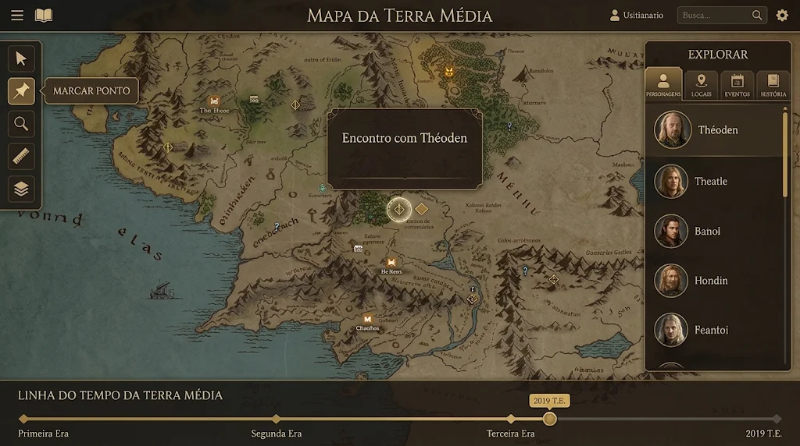
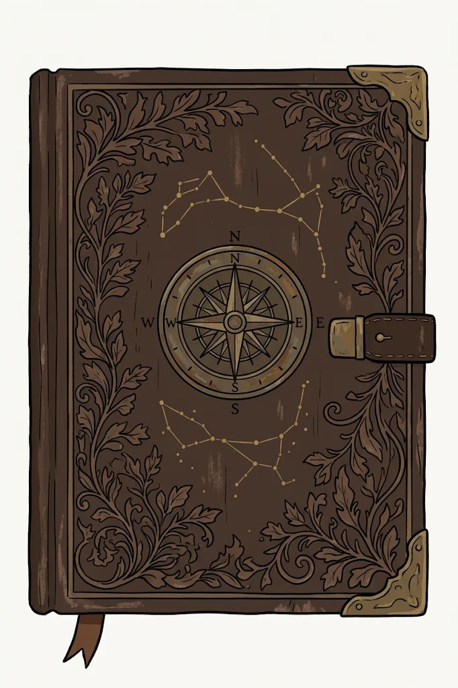
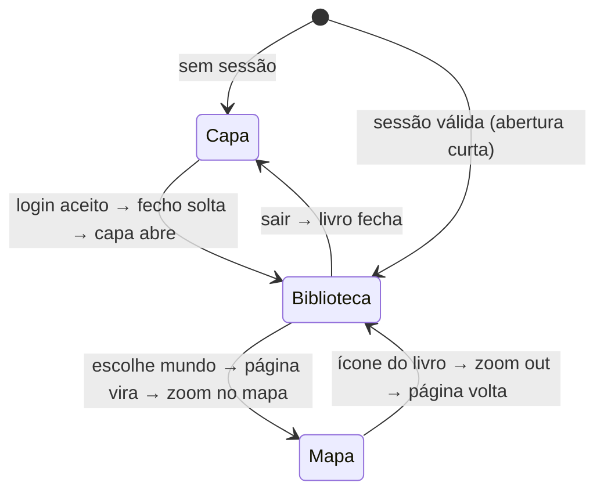

# 05 — Design

## Conceito: "o grimório do cartógrafo"
O **Worldbuilder's Dream** é apresentado como um **livro antigo de capa de couro**. O usuário entra pela capa, folheia até a biblioteca de mundos e, ao escolher um, vira a página e "cai" dentro do mapa. Dentro do mapa, a interface é um conjunto de **painéis de couro escuro com filetes dourados** sobre a carta cartográfica, como numa mesa de trabalho.

Três materiais guiam todas as decisões:

| Material | Papel na interface | Cor-base |
|----------|-------------------|----------|
| **Couro** (marrom) | barras, painéis, capa, fundos escuros | `couro-900 #2b1c12` |
| **Pergaminho** (bege claro) | páginas do livro, fichas, diálogos de leitura, texto sobre couro | `pergaminho-100 #efe3c8` |
| **Ouro** (dourado) | o que precisa chamar atenção | `ouro-400 #d9b25f` |

**Proporção 60-30-10:** cerca de 60% couro, 30% pergaminho e 10% ouro. O ouro é **reservado** para:
- cursor e trilho percorrido da linha do tempo;
- botão primário de cada tela (no máximo um por contexto);
- ferramenta ativa, aba ativa e item selecionado;
- anel do token selecionado, marcadores de evento e títulos de destaque;
- filetes e ornamentos.

## Referências visuais

### Referência 1: tela principal (mapa)


> Imagem usada só como **referência de composição e estilo**. O mapa mostrado é de uma obra de terceiros. O app não inclui mapas, nomes ou personagens de obras protegidas: os mapas são sempre importados pelo próprio usuário, e o app começa vazio.

| Elemento da referência | Como fica no app |
|------------------------|------------------|
| Mapa ocupando todo o fundo | `<wd-map-canvas>` em `position: fixed; inset: 0`; pan, zoom e arraste livres e independentes das barras. |
| **Barra superior** fina: ☰ + ícone de livro à esquerda, **título do mapa centralizado** em caixa-alta serifada, usuário, busca e engrenagem à direita | `wd-top-bar`, 48 px, couro 95% opaco, filete dourado inferior. O título mostra o mapa ativo e abre o seletor de mapas. O ícone de livro volta à biblioteca (com animação). A busca abre a paleta de comandos. |
| **Barra esquerda** flutuante com ferramentas em blocos quadrados | `wd-toolbar-left`: botões 44×44 com borda dourada sutil e tooltip à direita ("MARCAR PONTO", caixa-alta). Ferramenta ativa: fundo `ouro-400`, ícone `couro-950`. Sem botões de aproximar/afastar (o zoom é pela roda, pinça ou teclado); "enquadrar" recentra o mapa; camadas = visibilidade por camada. |
| **Barra direita "EXPLORAR"** com abas Personagens, Locais, Eventos, História | `wd-explorer`: título centralizado, cinco abas com ícone + rótulo pequeno (Personagens, Locais, **Acervo**, Eventos, História), aba ativa com filete dourado. **Acervo** reúne facções, itens e notas, com chips para filtrar o tipo (decisão de 2026-11-11). Lista com retratos na forma do tipo, anel colorido e nome em serifa; itens **arrastáveis para o mapa**. **História** lista os Google Docs do mundo (capítulos, manuscritos). |
| **Popover sobre o mapa** ancorado a um marcador | `wd-popover`: couro com borda dourada dupla e título em serifa; abre no hover/foco e expande para a ficha com um clique. |
| Marcador de evento em **losango dourado com halo** | Token de evento: losango com anel pulsante suave enquanto o evento acontece no instante atual. |
| Ícones de locais como **pequenos selos** | Tokens de local: selo quadrado arredondado com ícone. |
| **Linha do tempo** inferior com marcos de eras em losango, cursor circular dourado e etiqueta da data | `wd-timeline-bar` (~88 px): trilho percorrido em `ouro-400`, restante em `couro-600`; eras como losangos rotulados; eventos como losangos (pontuais) ou barras (com duração) na cor do marcador; cursor dourado com brilho; etiqueta flutuante com a data no calendário do mundo; à esquerda, play, velocidade e repetir; à direita, mostrar tudo, novo evento e calendário (sempre visíveis, para teclado e toque). |

Ajustes em relação à referência: barras laterais recolhíveis (`[` e `]`) que não cobrem a linha do tempo, e contraste conforme a tabela de [acessibilidade de cor](#acessibilidade-de-cor).

### Referência 2: capa do livro (tela de login)


| Elemento da capa | Uso no app |
|------------------|------------|
| Couro marrom com **arabescos de folhas em relevo** | Textura da capa e, bem sutil, dos painéis |
| **Rosa dos ventos** central em bronze | Emblema do app; na capa, também é o **indicador de carregamento** (gira devagar enquanto autentica) |
| **Constelações** douradas | Brilho animado (partículas cintilando) na capa e na biblioteca |
| **Cantoneiras** de metal | Ornamento nos diálogos importantes |
| **Fecho de couro** com botão de metal | Na capa, o fecho **se solta** quando o login é aceito, antes de o livro abrir |
| **Fita marcadora** | Na biblioteca, aponta o último mundo aberto |

A arte final da capa deve ser **própria** e entregue **em camadas** (base de couro, relevo, rosa dos ventos, constelações, cantoneiras, fecho, fita), em SVG para o que for vetor e WebP/AVIF para texturas.

## Paleta de cores

### Primitivos
| Família | Token | Hex | Uso típico |
|---------|-------|-----|-----------|
| **Couro** | `couro-950` | `#1f140d` | fundo atrás do mapa e da capa; texto sobre ouro |
| | `couro-900` | `#2b1c12` | painéis e barras |
| | `couro-800` | `#3a2618` | painel elevado, hover em listas |
| | `couro-700` | `#4e3422` | aba ativa, campos sobre couro |
| | `couro-600` | `#6b4a30` | trilho não percorrido, divisores; texto escuro sobre pergaminho |
| | `couro-500` | `#8a6444` | ícones desativados, bordas fortes |
| **Pergaminho** | `pergaminho-50` | `#f4ead3` | páginas do livro, fichas, diálogos de leitura |
| | `pergaminho-100` | `#efe3c8` | texto principal sobre couro |
| | `pergaminho-200` | `#e3d2ac` | páginas em segundo plano, cards sobre pergaminho |
| | `pergaminho-300` | `#d2bb8b` | bordas sobre pergaminho |
| | `pergaminho-400` | `#c9b48e` | texto secundário sobre couro |
| **Ouro** | `ouro-200` | `#f0dca6` | brilhos de animação |
| | `ouro-300` | `#e8c97a` | hover de elementos dourados; anel de foco |
| | `ouro-400` | `#d9b25f` | **destaque principal**: slider, botão primário, seleção |
| | `ouro-500` | `#b8903f` | pressionado, filetes, ícones dourados |
| | `ouro-700` | `#8a6a2a` | ouro sobre pergaminho (só texto ≥ 24 px e ornamentos) |
| **Apoio** | `lacre` | `#a33a2a` | destrutivo e erros sobre pergaminho |
| | `lacre-claro` | `#e07a5f` | destrutivo e erros sobre couro |
| | `musgo` | `#7f9a62` | sucesso, salvo |
| | `tinta` | `#5c7fa3` | informação; links sobre pergaminho (com sublinhado) |
| **Entidades** | `bronze` | `#9c7a4e` | anel padrão de local |
| | `cobre` | `#8c5a3c` | anel padrão de facção |
| | `latao` | `#b5a27a` | anel padrão de item |

### Semânticos
```css
:root {
  --wd-bg-backdrop:        var(--couro-950);
  --wd-surface:            var(--couro-900);
  --wd-surface-raised:     var(--couro-800);
  --wd-surface-active:     var(--couro-700);
  --wd-page:               var(--pergaminho-50);
  --wd-page-muted:         var(--pergaminho-200);
  --wd-text-on-surface:    var(--pergaminho-100);
  --wd-text-muted:         var(--pergaminho-400);
  --wd-text-on-page:       var(--couro-900);
  --wd-text-on-page-muted: var(--couro-600);
  --wd-text-on-accent:     var(--couro-950);
  --wd-accent:             var(--ouro-400);
  --wd-accent-hover:       var(--ouro-300);
  --wd-accent-pressed:     var(--ouro-500);
  --wd-accent-glow:        color-mix(in oklab, var(--ouro-300) 55%, transparent);
  --wd-rule:               color-mix(in oklab, var(--ouro-500) 40%, transparent);
  --wd-rule-strong:        var(--ouro-500);
  --wd-divider:            color-mix(in oklab, var(--couro-500) 50%, transparent);
  --wd-danger:             var(--lacre-claro);
  --wd-success:            var(--musgo);
  --wd-focus-ring:         var(--ouro-300);
}
```

### Cores por tipo de entidade
Cada tipo tem **forma própria**, nunca só a cor:

| Tipo | Forma | Anel padrão |
|------|-------|-------------|
| Personagem | retrato circular | `ouro-400` |
| Local | selo quadrado arredondado | `#9c7a4e` (bronze) |
| Evento | losango | `ouro-300` com halo |
| Facção | escudo | `#8c5a3c` (cobre) |
| Item | hexágono | `#b5a27a` (latão claro) |
| Nota | folha com canto dobrado | `pergaminho-400` |

O usuário pode trocar a cor de cada entidade, a partir de uma paleta "de tintas antigas" (sépia, vermelho-lacre, verde-musgo, azul-tinta, violeta-amora).

### Acessibilidade de cor
| Combinação | Contraste | Uso permitido |
|-----------|-----------|---------------|
| `pergaminho-100` sobre `couro-900` | 12,9 : 1 | qualquer texto |
| `pergaminho-400` sobre `couro-900` | 8,1 : 1 | texto secundário |
| `ouro-400` sobre `couro-900` | 8,2 : 1 | texto e ícones dourados nas barras |
| `couro-950` sobre `ouro-400` | 9,0 : 1 | rótulo do botão primário |
| `couro-900` sobre `pergaminho-50` | 13,7 : 1 | texto das páginas |
| `couro-600` sobre `pergaminho-50` | 6,6 : 1 | texto secundário nas páginas |
| `lacre` sobre `pergaminho-50` | 5,5 : 1 | erros nas páginas |
| `lacre-claro` sobre `couro-900` | 5,6 : 1 | erros nas barras |
| `ouro-700` sobre `pergaminho-50` | 4,2 : 1 | **somente** texto ≥ 24 px, ícones e ornamentos; anel de foco sobre pergaminho |
| `couro-950` sobre `ouro-300` | 11,2 : 1 | botão primário em hover |
| `pergaminho-100` sobre `couro-800` | 11,2 : 1 | botão secundário sobre couro |
| `couro-900` sobre `pergaminho-200` | 11,0 : 1 | botão secundário sobre pergaminho |
| `pergaminho-50` sobre `lacre` | 5,5 : 1 | rótulo do botão destrutivo |
| `tinta` / `musgo` sobre `couro-900` | 3,9 / 5,2 : 1 | ícones de aviso (informação, sucesso) |

Os controles secundário e fantasma usam os tokens `--wd-control-*`, que `.wd-page` redefine para as cores de pergaminho; dentro de `.wd-page` o anel de foco passa a `ouro-700`.

Rótulos sobre o mapa: texto `pergaminho-50` com contorno `couro-950`, legível sobre qualquer imagem.

## Tipografia
| Papel | Fonte | Onde |
|-------|-------|------|
| **Inscrição** | **Cinzel** | títulos de barra ("MAPA DE …", "EXPLORAR", "LINHA DO TEMPO …"), tooltips de ferramenta, eras, título da capa; sempre caixa-alta com `letter-spacing: 0.08em` |
| **Livro** | **EB Garamond** | nomes na lista, títulos de fichas e popovers, texto das fichas e dos Docs, páginas da biblioteca |
| **Interface** | **Inter** | campos, menus, números pequenos, configurações |
| **Medidas** | **JetBrains Mono** | régua, coordenadas, ticks |

Fontes OFL, **auto-hospedadas** (`font-display: swap`, subset latino). Escala: 12 / 14 / 16 / 18 / 22 / 28 / 36 / 56.

## Texturas, bordas e ornamentos
- **Couro**: textura em mosaico (WebP 512 px, opacidade 6–10%) nos painéis.
- **Pergaminho**: fibras e vinheta nas páginas e fichas.
- **Filete dourado duplo**: `1px solid var(--wd-rule)` + filete interno a 3–4 px.
- **Cantoneiras** SVG nos diálogos importantes.
- **Divisores** com losango dourado central.
- **Sombra** quente (`0 8px 24px rgb(15 9 5 / 0.45)`); painéis **opacos**, sem vidro fosco.
- **Raio**: 6 px em controles, 10 px em painéis, 999 px em retratos e cursor.
- Modo **alto contraste**: sem texturas, bordas sólidas, texto secundário maior.

## Bibliotecas e responsabilidades
| Camada | Responsável |
|--------|-------------|
| Comportamento e acessibilidade | **Angular CDK** (overlay, dialog, menu, listbox, drag-and-drop, foco, anúncios) |
| Todo o visual | **Tailwind CSS v4** + tokens desta página, em componentes próprios (`docs/04`) |
| Animações e efeitos | Componentes portados da **Skiper UI** e da **Magic UI** + animações próprias do livro |

Animação com propósito: dentro do mapa, só animações funcionais e curtas (≤ 200 ms). Efeitos de espetáculo ficam na capa, na biblioteca e em marcos.

## Implementação do tema (só CSS)
```
src/styles/
├── palette.css    # primitivos (fonte única dos hex)
├── tokens.css     # semânticos --wd-* (cores, forma, movimento)
├── fonts.css      # @font-face das fontes auto-hospedadas
├── textures.css   # couro, pergaminho, vinheta; alto contraste
└── styles.css     # entrada: Tailwind, @theme, base e componentes
```
`styles.css` (resumo):
```css
@import "tailwindcss";
@import "./palette.css";
@import "./tokens.css";
@import "./fonts.css";
@import "./textures.css";

/* Sem os padrões do Tailwind: só as cores, fontes e tamanhos do projeto. */
@theme { --color-*: initial; --font-*: initial; --text-*: initial; }

/* Utilitários apontam para palette.css, sem repetir hex. */
@theme inline {
  --color-couro-900: var(--couro-900);   /* … todas as cores da paleta */
  --radius-control: var(--wd-radius-control);
  --radius-panel: var(--wd-radius-panel);
  --shadow-panel: var(--wd-shadow-panel);
}

@theme {
  --font-inscription: 'Cinzel', serif;
  --font-book: 'EB Garamond', 'Georgia', serif;
  --font-sans: 'Inter', system-ui, sans-serif;
  --font-mono: 'JetBrains Mono', ui-monospace, monospace;
  --text-xs: 0.75rem;   /* … escala 12 / 14 / 16 / 18 / 22 / 28 / 36 / 56 em text-xs … text-4xl */
}

@layer components {
  .wd-panel {        /* couro com filete dourado duplo */
    border: 1px solid var(--wd-rule);
    border-radius: var(--wd-radius-panel);
    outline: 1px solid var(--wd-rule-inner);
    outline-offset: -4px;
    background-color: color-mix(in oklab, var(--wd-surface) 95%, transparent);
    background-image: var(--wd-texture-leather);
    color: var(--wd-text-on-surface);
    box-shadow: var(--wd-shadow-panel);
  }
  .wd-page {         /* pergaminho com fibras e vinheta */
    background-color: var(--wd-page);
    background-image: var(--wd-vignette-page), var(--wd-texture-parchment);
    color: var(--wd-text-on-page);
  }
  .wd-inscription { font-family: var(--font-inscription); text-transform: uppercase; letter-spacing: 0.08em; }
  .wd-focus:focus-visible { outline: 2px solid var(--wd-focus-ring); outline-offset: 2px; }
}
```
- A camada `base` aplica o fundo `--wd-bg-backdrop`, a seleção dourada e o anel de foco `:focus-visible` em todos os elementos.
- **Alto contraste**: `@media (prefers-contrast: more)` ou `<html data-contrast="more">` (para a futura preferência do app) zeram as texturas e deixam os filetes sólidos.
- **Texturas provisórias**: `src/assets/textures/*.svg` são ruído procedural próprio; a arte final (WebP/AVIF 512 px) substitui os arquivos sem mudar o CSS.
- **Fontes**: `src/assets/fonts/<fonte>/` com o `.woff2` variável (subset latino) e o `OFL.txt`; atribuição em `THIRD_PARTY_NOTICES.md`.
- **Contraste verificado**: `scripts/ci/check-contrast.mjs` (parte do `pnpm lint`) lê `palette.css` e falha se uma combinação da tabela de [acessibilidade de cor](#acessibilidade-de-cor) cair abaixo do mínimo.

Comentários em CSS sempre com `/* */`. Os overlays do CDK precisam de `@angular/cdk/overlay-prebuilt.css` (ou o equivalente em CSS), importado antes das camadas do Tailwind.

## Movimento

### Tokens
| Token | Valor | Uso |
|-------|-------|-----|
| `--wd-dur-fast` | 120 ms | hover, foco |
| `--wd-dur-base` | 200 ms | painéis e popovers |
| `--wd-dur-slow` | 360 ms | diálogos, troca de aba |
| `--wd-dur-page` | 900 ms | virada de página |
| `--wd-dur-cover` | 1200 ms | abertura da capa |
| `--wd-dur-page-short` / `--wd-dur-cover-short` | 450 / 500 ms | virada e abertura na versão curta |
| `--wd-dur-clasp` | 350 ms | fecho da capa soltando |
| `--wd-dur-zoom` / `--wd-dur-zoom-short` | 700 / 350 ms | zoom da página até o mapa (View Transition) |
| `--wd-dur-fade` | 150 ms | fade cruzado do movimento reduzido |
| `--wd-ease-out` | `cubic-bezier(.2,.8,.2,1)` | entradas |
| `--wd-ease-page` | `cubic-bezier(.45,.05,.25,1)` | virada de página |
| `--wd-ease-in-out` | `cubic-bezier(.65,0,.35,1)` | movimento de tokens na reprodução |

Só se animam `transform`, `opacity` e `filter` leve.

### Transições do livro
Decisão em [ADR-0011](adr/0011-navegacao-como-livro.md).



#### 1. Capa (login), rota `/`
**Cena:** fundo `couro-950` com vinheta e luz quente de cima, como um livro sobre uma mesa à luz de vela. O livro fica centralizado, em leve perspectiva, com cerca de 80% da altura da tela.

**Placa da capa:** sob a rosa dos ventos, uma placa de pergaminho emoldurada em ouro com:
- título **WORLDBUILDER'S DREAM** em Cinzel dourado, gravado;
- uma linha em EB Garamond itálico ("Um atlas para os seus mundos");
- o botão primário dourado **Entrar com Google** (ícone do Google em versão monocromática `couro-950`, conforme as diretrizes de marca do Google).

Não há campos de e-mail ou senha. Se o e-mail não estiver autorizado, a placa mostra em `lacre`: "Este e-mail não tem acesso a este livro" e o botão continua disponível para tentar outra conta.

**Modo convite** (`/convite`): a mesma capa, com a placa mostrando "Você foi convidado para este livro" em EB Garamond, o e-mail convidado em destaque e, abaixo, os nomes dos mundos incluídos (em itálico). O botão vira **Aceitar e entrar com Google**. Convite inválido: placa com selo de lacre e "Este convite não é mais válido".

**E-mail do convite** (HTML simples e compatível com clientes de e-mail): fundo `pergaminho-50`, faixa superior `couro-900` com "WORLDBUILDER'S DREAM" em letras douradas (imagem, porque clientes de e-mail não carregam fontes), texto "<nome> convidou você para o livro de mundos dele", botão dourado **Aceitar convite**, a linha "Entre com a conta Google <e-mail>", a validade e "Se você não esperava este convite, pode ignorar este e-mail". Sempre com versão em texto puro.

**Em repouso** (pausado com movimento reduzido): constelações cintilando, poeira dourada esparsa na luz e paralaxe sutil da capa seguindo o ponteiro (máx. 3°).

**Ao entrar:**
1. Ao voltar do Google, a **rosa dos ventos gira** enquanto a sessão é finalizada (`aria-busy` na placa).
2. O **fecho de couro se solta** (~350 ms).
3. A **capa abre**, girando em torno da lombada (`rotateY(0 → -180deg)`, perspectiva 2000 px, `--wd-dur-cover`), revelando o verso da capa com o ex-libris do usuário e a primeira página.
4. Aproximação leve até o livro aberto ocupar a tela; rota `/biblioteca`.

#### 2. Biblioteca (livro aberto), rota `/biblioteca`
- **Página esquerda, "Sumário"**: mundos como índice de livro (nome em EB Garamond, linha pontilhada, data da última edição). Ao final, "✒ Criar novo mundo". A **fita marcadora** aponta o último mundo aberto. Muitos mundos são paginados com virada de página.
- **Página direita, "Frontispício"** do mundo selecionado: miniatura do mapa emoldurada, nome em Cinzel, descrição em itálico, contagem de personagens, locais e eventos, intervalo de tempo coberto e o botão dourado **Abrir mundo**. Ações secundárias (renomear, duplicar, arquivar, exportar, membros, lixeira) no menu "⋯".
- **Livro em branco** (nenhum mundo): página esquerda vazia com ilustração em traço de pena e "Seu livro está em branco"; página direita com **Criar primeiro mundo**.
- Na primeira abertura da sessão, os itens entram com efeito de **escrita a tinta**.

#### 3. Virada de página para o mapa, rota `/w/:worldId`
1. **Abrir mundo** começa a carregar os dados na hora (a animação mascara a latência).
2. A **página direita vira** (`--wd-dur-page`, `--wd-ease-page`), com sombra se deslocando e leve curvatura.
3. A nova página mostra o **mapa do mundo em página inteira** com moldura dourada (ou a folha da área de importação, se o mundo não tem mapa).
4. **Zoom para dentro**: a ilustração expande até a viewport (View Transition `wd-world-map`); as bordas do livro saem de quadro.
5. As barras **entram deslizando** (topo → esquerda → direita → linha do tempo, 60 ms de intervalo) e o cursor do tempo brilha uma vez.

Se os dados ainda não chegaram, a página mostra a miniatura com a rosa dos ventos girando no canto: a animação **nunca fica parada em silêncio por mais de 300 ms**.

#### 4. Voltar e sair
- **Ícone de livro**: barras recolhem, o mapa encolhe de volta à página e a página volta para a biblioteca.
- **Sair**: o livro fecha (capa gira de volta, fecho prende) e volta à capa.

#### Regras
- **Puláveis**: clique, toque, `Esc` ou `Enter` levam ao estado final.
- **Versão curta** quando a sessão já é válida (capa abre em 500 ms, sem o fecho).
- **Sempre completas**: não há preferência no app (decisão de 2026-11-11, ADR-0011). As exceções são automáticas: movimento reduzido no sistema e fps baixo.
- `prefers-reduced-motion: reduce` → fade cruzado de 150 ms.
- Links diretos (`/w/:id?t=…`) abrem o mapa sem animação.
- Ao fim de cada transição o foco vai para o título da nova tela e uma região `aria-live` anuncia "Biblioteca de mundos" ou "Mapa: <nome>".
- `will-change` só durante a animação e só na propriedade animada (`will-change: opacity` achata o `preserve-3d` do livro); se o primeiro quadro demorar demais (fps baixo), usa-se automaticamente a versão curta até o fim da sessão.
- **Versão curta**: capa em 500 ms sem o fecho, virada rígida (um plano) em 450 ms, zoom em 350 ms. **Completas**: fecho, capa em 1200 ms, virada curvada em 900 ms, zoom em 700 ms.
- **Mundo sem mapa**: a página do mapa mostra a folha de pergaminho com borda tracejada e a rosa dos ventos, e a tela do mundo mostra a área de importação. Com mapa, a página mostra a miniatura do mapa.

## Componentes animados: Skiper UI + Magic UI
| Catálogo | Stack original | Licença (gratuitos) |
|----------|---------------|---------------------|
| **[Magic UI](https://magicui.design)** | React + Tailwind + Motion | MIT (manter aviso de copyright) |
| **[Skiper UI](https://skiper-ui.com)** | React/Next.js + Tailwind + framer-motion (alguns com GSAP) | uso pessoal e comercial **com atribuição**; usamos **apenas** os gratuitos |

Os componentes são **portados para Angular** (standalone, signals; CSS, Web Animations ou `motion` vanilla). Processo e licenças: [ADR-0003](adr/0003-skiper-ui-e-magic-ui-portados-para-angular.md). As atribuições ficam no cabeçalho de cada arquivo e em `THIRD_PARTY_NOTICES.md` (não há página de créditos no app).

### No MVP (5)
| Componente | Inspiração | Onde |
|------------|-----------|------|
| `wd-page-flip` | animação própria (+ efeitos de página gratuitos da Skiper UI, se houver) | capa e virada de página |
| `wd-sparkles` | Magic UI *Sparkles Text* / *Particles* | constelações e poeira da capa e da biblioteca |
| `wd-border-beam` / `wd-shine-border` | Magic UI *Border Beam* / *Shine Border* | evento ativo, placa da capa, área de importação ao arrastar |
| `wd-blur-fade` | Magic UI *Blur Fade* | entrada de listas e cards |
| `wd-number-ticker` | Magic UI *Number Ticker* | ano na etiqueta do tempo durante o play |

### Depois, sob demanda
`wd-text-reveal` (escrita a tinta na biblioteca), `wd-tilt-card` (inclinação de cards), `wd-shimmer-button` (reflexo no botão dourado), `wd-animated-beam` (grafo de relações), `wd-orbiting` (carregamento) e `wd-confetti` (folhas douradas no primeiro token).

Todo componente portado: fica em `shared/motion/`, respeita movimento reduzido e a preferência do livro, e não carrega nada de CDN.

## Padrões de UI específicos
- **Token de personagem**: retrato circular com anel dourado (2 px); nome em rótulo de pergaminho embaixo (zoom ≥ limiar ou hover); selecionado: anel duplo `ouro-300` com brilho. Os demais tipos usam a forma do avatar do Explorar (selo, escudo, hexágono, folha) com o anel na cor do tipo ou da entidade; sem retrato, inicial (personagem) ou ícone do tipo. O token tem 32 px na tela em qualquer zoom.
- **Rastro de movimento**: linha tracejada `ouro-500` entre keyframes, com pequenos losangos em cada keyframe (vazados onde o token sai do mapa); traços curtos `ouro-300` sob o trilho da linha do tempo marcam as mesmas posições.
- **Popover do mapa**: até 320 px; título em EB Garamond 20 px; ações em ícones na base.
- **Ficha da entidade**: painel com **página de pergaminho**, retrato emoldurado e abas Resumo · Texto · Relações · Aparições · Documentos (no M2, só Resumo e Texto; as demais entram com os marcos que as alimentam). Sobre pergaminho, abas e controles usam `--wd-control-muted`, `--wd-control-selected` (couro-900) e `--wd-control-selected-rule` (ouro-700). Quando o texto é um Google Doc, um selo discreto "Google Doc" e o botão **Editar no Google Docs** ficam no topo da aba Texto.
- **Texto de Google Doc**: mesma tipografia de livro; nomes de entidades sublinhados em pontilhado `ouro-700`; datas-âncora com pequeno losango dourado à esquerda.
- **Confirmação destrutiva**: selo de lacre no topo e botão `lacre` com o nome do item ("Excluir 'Valmora'").

### Área de importação de mapa (mundo sem mapa)
- **Visual**: grande folha de pergaminho emoldurada no centro do fundo `couro-950`, com **borda tracejada dourada** (`ouro-500`) e a rosa dos ventos em traço fino. Texto em EB Garamond: "**Arraste a imagem do seu mapa para cá**" e, menor, "PNG, JPG ou WebP". Botões **Escolher arquivo** (primário) e **Do Google Drive** (secundário).
- **Arrastando um arquivo sobre a janela**: a moldura acende (borda contínua `ouro-300` + `wd-border-beam`), o fundo escurece levemente e o texto muda para "**Solte para criar o mapa**". Arquivo que não é imagem: moldura em `lacre-claro` e "Este arquivo não é uma imagem".
- **Ao soltar**: a imagem aparece na hora, a folha "assenta" na mesa (escala 1,02 → 1, 200 ms), as barras entram e um anel de progresso no canto mostra o envio. O nome do mapa vem do nome do arquivo (editável no título). Um aviso discreto oferece "**Definir escala**".
- **Com mapa existente**: soltar uma imagem abre um diálogo pequeno, "Criar novo mapa" (fica dentro do atual na árvore) ou "Substituir a imagem deste mapa"; sobre o mapa, uma moldura dourada indica onde soltar. `Ctrl/Cmd+V` faz o mesmo. "Do Google Drive" fica desativado até a Fase 2.
- **Acessibilidade**: "Escolher arquivo" é o caminho principal por teclado e leitor de tela; a área tem `aria-describedby` com as instruções.

## Responsividade
- **Desktop (≥ 1024 px)**: layout completo; livro em página dupla.
- **Tablet (768–1023 px)**: barras recolhidas por padrão e abertas como overlay; livro em página única.
- **Celular (< 768 px)**: capa em tela cheia, biblioteca em página única, mapa em modo visualização (navegar mapa e tempo, ler fichas); partículas e paralaxe desligadas.

## Acessibilidade
- Contrastes conforme a tabela; anel de foco `ouro-300` (2 px + deslocamento de 2 px) em todos os controles.
- Ornamentos e texturas com `aria-hidden`; a capa tem `h1` real com o nome do app.
- Nada pisca mais de 3 vezes por segundo.
