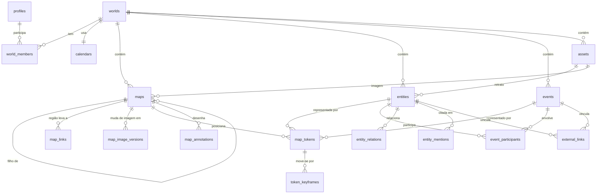

# 07 — Dados

Postgres gerenciado pelo Supabase. Este documento traz o **modelo**, uma **DDL de referência** para a primeira migração, as **políticas RLS** e as regras de evolução.

> A DDL abaixo é a referência de design. A fonte da verdade, depois de criada, são os arquivos em `supabase/migrations/`.

## Diagrama entidade-relacionamento


## Convenções
- Chaves primárias `uuid` (`gen_random_uuid()`); para tabelas de alto volume (`token_keyframes`) também `uuid` por simplicidade com PostgREST.
- Toda tabela de domínio tem `world_id` (desnormalizado quando necessário) → simplifica RLS e índices.
- Colunas padrão: `created_at timestamptz default now()`, `updated_at timestamptz` (trigger), `created_by uuid`, `version int default 1` (trigger incrementa), `deleted_at timestamptz` (lixeira com retenção de 30 dias) nas tabelas principais.
- Enums como **tipos `enum`** só quando realmente fixos (`member_role`, `interp_mode`, `asset_source`); listas que tendem a crescer (tipos de entidade, categorias de evento) usam `text` + `check`.
- Textos ricos: `content jsonb` (Tiptap) + `content_text text` (derivado no cliente e validado por tamanho) + `search tsvector` (coluna gerada).
- Busca: dicionário `simple` + extensão `unaccent` (nomes inventados não se beneficiam de stemming do português).

## Modelos no front (`domain/models`)
- Um tipo por tabela, com os mesmos campos em **camelCase** (`world_id` → `worldId`); o adaptador Supabase converte linha ⇄ modelo. `maps` vira `WorldMap` e `events` vira `WorldEvent`, para não colidir com `Map` e `Event`.
- Ficam de fora as colunas geradas pelo banco (`search`) e o schema `private`.
- `timestamptz` vira texto ISO (`IsoDateTime`); `bigint` de tempo vira `Tick` (`number` inteiro seguro); `jsonb` vira `Json`/`JsonObject`, ou `RichTextDoc` para conteúdo do Tiptap.
- As portas (`domain/ports`) são **classes abstratas**, usadas diretamente como token de injeção (`inject(WorldRepository)`) sem que o domain importe Angular. `update` e `moveToTrash` recebem a `version` vista pelo cliente e rejeitam com `AppError('conflict')` se o item mudou.

## DDL de referência (migração inicial)
```sql
-- 0. Extensões
create extension if not exists pgcrypto;
create extension if not exists unaccent with schema extensions;

-- 1. Tipos
create type public.member_role as enum ('owner', 'editor');
create type public.interp_mode as enum ('linear', 'step', 'ease');
create type public.asset_source as enum ('storage', 'google_drive', 'external_url');

-- 2. Perfis (1:1 com auth.users)
create table public.profiles (
  id          uuid primary key references auth.users(id) on delete cascade,
  display_name text not null check (char_length(display_name) between 1 and 80),
  avatar_path text,
  locale      text not null default 'pt-BR',
  ui_prefs    jsonb not null default '{}'::jsonb check (pg_column_size(ui_prefs) < 16384),
  created_at  timestamptz not null default now(),
  updated_at  timestamptz not null default now()
);

-- 3. Mundos e membros
create table public.worlds (
  id          uuid primary key default gen_random_uuid(),
  owner_id    uuid not null references public.profiles(id) on delete cascade,
  name        text not null check (char_length(name) between 1 and 120),
  description text check (char_length(description) <= 2000),
  cover_asset_id uuid,
  time_start  bigint not null default 0,
  time_end    bigint not null default 525600 * 100,   -- 100 anos em minutos
  now_tick    bigint,                                  -- "agora da narrativa" opcional
  archived_at timestamptz,
  deleted_at  timestamptz,
  version     int not null default 1,
  created_at  timestamptz not null default now(),
  updated_at  timestamptz not null default now(),
  check (time_end > time_start)
);

create table public.world_members (
  world_id   uuid not null references public.worlds(id) on delete cascade,
  user_id    uuid not null references public.profiles(id) on delete cascade,
  role       public.member_role not null,
  created_at timestamptz not null default now(),
  primary key (world_id, user_id)
);
create index on public.world_members (user_id);

create table public.calendars (
  world_id   uuid primary key references public.worlds(id) on delete cascade,
  definition jsonb not null,           -- validado no cliente (zod) e por check de chaves mínimas
  updated_at timestamptz not null default now(),
  check (definition ? 'months' and definition ? 'hoursPerDay')
);

-- 4. Assets (imagens)
create table public.assets (
  id          uuid primary key default gen_random_uuid(),
  world_id    uuid not null references public.worlds(id) on delete cascade,
  source      public.asset_source not null,
  storage_path text,                    -- quando source = 'storage'
  external_id text,                     -- Drive file id
  external_url text check (external_url is null or external_url ~ '^https://'),
  mime_type   text not null,
  width       int, height int,
  size_bytes  bigint not null default 0,
  created_by  uuid not null references public.profiles(id),
  created_at  timestamptz not null default now(),
  check (
    (source = 'storage' and storage_path is not null) or
    (source = 'google_drive' and external_id is not null) or
    (source = 'external_url' and external_url is not null)
  )
);
create index on public.assets (world_id);

-- 5. Mapas
create table public.maps (
  id            uuid primary key default gen_random_uuid(),
  world_id      uuid not null references public.worlds(id) on delete cascade,
  parent_map_id uuid references public.maps(id) on delete set null,
  name          text not null check (char_length(name) between 1 and 120),
  image_asset_id uuid references public.assets(id) on delete set null,
  width         int not null check (width between 1 and 32768),
  height        int not null check (height between 1 and 32768),
  scale_value   double precision check (scale_value > 0),  -- unidades por pixel
  scale_unit    text check (scale_unit in ('m','km','mi','league','day_walk','custom')),
  scale_label   text,
  sort_order    int not null default 0,
  deleted_at    timestamptz,
  version       int not null default 1,
  created_at    timestamptz not null default now(),
  updated_at    timestamptz not null default now()
);
create index on public.maps (world_id, parent_map_id);

create table public.map_links (
  id            uuid primary key default gen_random_uuid(),
  world_id      uuid not null references public.worlds(id) on delete cascade,
  map_id        uuid not null references public.maps(id) on delete cascade,
  target_map_id uuid not null references public.maps(id) on delete cascade,
  polygon       jsonb not null,         -- [[x,y],...] em coordenadas do mapa-pai
  check (map_id <> target_map_id)
);

-- Versões da imagem no tempo (docs/06 §1): a imagem do mapa vale até a primeira versão;
-- cada versão vale até o tick_start da seguinte
create table public.map_image_versions (
  id             uuid primary key default gen_random_uuid(),
  world_id       uuid not null references public.worlds(id) on delete cascade,
  map_id         uuid not null references public.maps(id) on delete cascade,
  image_asset_id uuid references public.assets(id) on delete set null,
  tick_start     bigint not null,
  deleted_at     timestamptz,
  version        int not null default 1,
  created_by     uuid references public.profiles(id),
  created_at     timestamptz not null default now(),
  updated_at     timestamptz not null default now()
);
create unique index on public.map_image_versions (map_id, tick_start) where deleted_at is null;

-- 6. Entidades
create table public.entities (
  id            uuid primary key default gen_random_uuid(),
  world_id      uuid not null references public.worlds(id) on delete cascade,
  kind          text not null check (kind in ('character','location','faction','item','note')),
  name          text not null check (char_length(name) between 1 and 160),
  subtitle      text check (char_length(subtitle) <= 200),
  color         text check (color ~ '^#[0-9a-fA-F]{6}$'),
  portrait_asset_id uuid references public.assets(id) on delete set null,
  aliases       text[] not null default '{}',              -- apelidos, usados para reconhecer a entidade nos Google Docs
  attributes    jsonb not null default '{}'::jsonb check (pg_column_size(attributes) < 65536),
  content       jsonb,                                    -- Tiptap
  content_text  text check (char_length(content_text) <= 500000),
  born_tick     bigint, died_tick bigint,                 -- ciclo de vida opcional
  tags          text[] not null default '{}',
  search        tsvector generated always as (
                  setweight(to_tsvector('simple', coalesce(name,'')), 'A') ||
                  setweight(to_tsvector('simple', coalesce(subtitle,'')), 'B') ||
                  setweight(to_tsvector('simple', coalesce(content_text,'')), 'C')
                ) stored,
  deleted_at    timestamptz,
  version       int not null default 1,
  created_by    uuid references public.profiles(id),
  created_at    timestamptz not null default now(),
  updated_at    timestamptz not null default now()
);
create index on public.entities (world_id, kind) where deleted_at is null;
create index entities_search_idx on public.entities using gin (search);
-- Observação: to_tsvector com unaccent exige função IMMUTABLE wrapper; ver migração de busca.

create table public.entity_relations (
  id          uuid primary key default gen_random_uuid(),
  world_id    uuid not null references public.worlds(id) on delete cascade,
  from_id     uuid not null references public.entities(id) on delete cascade,
  to_id       uuid not null references public.entities(id) on delete cascade,
  relation    text not null check (char_length(relation) between 1 and 60), -- 'pai de', 'aliado', 'membro de'
  tick_start  bigint, tick_end bigint,
  check (from_id <> to_id)
);
create index on public.entity_relations (world_id, from_id);

-- Menções (@entidade) dentro de textos ricos; mantidas pelo cliente ao salvar o conteúdo
create table public.entity_mentions (
  world_id        uuid not null references public.worlds(id) on delete cascade,
  source_kind     text not null check (source_kind in ('entity','event')),
  source_id       uuid not null,               -- entidade ou evento que contém o texto
  target_entity_id uuid not null references public.entities(id) on delete cascade,
  primary key (source_kind, source_id, target_entity_id)
);
create index on public.entity_mentions (target_entity_id);   -- "onde esta personagem é citada"

-- 7. Eventos
create table public.events (
  id            uuid primary key default gen_random_uuid(),
  world_id      uuid not null references public.worlds(id) on delete cascade,
  title         text not null check (char_length(title) between 1 and 200),
  category      text not null default 'general',
  tick_start    bigint not null,
  tick_end      bigint,
  location_entity_id uuid references public.entities(id) on delete set null,
  content       jsonb,
  content_text  text check (char_length(content_text) <= 200000),
  color         text check (color ~ '^#[0-9a-fA-F]{6}$'),
  search        tsvector generated always as (
                  setweight(to_tsvector('simple', coalesce(title,'')), 'A') ||
                  setweight(to_tsvector('simple', coalesce(content_text,'')), 'C')
                ) stored,
  deleted_at    timestamptz,
  version       int not null default 1,
  created_by    uuid references public.profiles(id),
  created_at    timestamptz not null default now(),
  updated_at    timestamptz not null default now(),
  check (tick_end is null or tick_end >= tick_start)
);
create index on public.events (world_id, tick_start) where deleted_at is null;
create index events_search_idx on public.events using gin (search);

create table public.event_participants (
  event_id  uuid not null references public.events(id) on delete cascade,
  entity_id uuid not null references public.entities(id) on delete cascade,
  world_id  uuid not null references public.worlds(id) on delete cascade,
  role      text,
  primary key (event_id, entity_id)
);

-- 8. Tokens e keyframes
create table public.map_tokens (
  id         uuid primary key default gen_random_uuid(),
  world_id   uuid not null references public.worlds(id) on delete cascade,
  map_id     uuid not null references public.maps(id) on delete cascade,
  entity_id  uuid references public.entities(id) on delete cascade,
  event_id   uuid references public.events(id) on delete cascade,
  size       real not null default 1 check (size between 0.1 and 10),
  style      jsonb not null default '{}'::jsonb,
  created_at timestamptz not null default now(),
  check ((entity_id is null) <> (event_id is null)),       -- exatamente um
  unique (map_id, entity_id),
  unique (map_id, event_id)
);
create index on public.map_tokens (world_id);

create table public.token_keyframes (
  id            uuid primary key default gen_random_uuid(),
  world_id      uuid not null references public.worlds(id) on delete cascade,
  token_id      uuid not null references public.map_tokens(id) on delete cascade,
  tick          bigint not null,
  x             real not null,
  y             real not null,
  visible       boolean not null default true,
  interpolation public.interp_mode not null default 'linear',
  note          text check (char_length(note) <= 500),
  updated_at    timestamptz not null default now(),
  unique (token_id, tick)
);
create index on public.token_keyframes (token_id, tick);

-- 9. Anotações (pinos, traços, regiões, rótulos, medições)
create table public.map_annotations (
  id          uuid primary key default gen_random_uuid(),
  world_id    uuid not null references public.worlds(id) on delete cascade,
  map_id      uuid not null references public.maps(id) on delete cascade,
  kind        text not null check (kind in ('pin','stroke','region','label','measure')),
  geometry    jsonb not null check (pg_column_size(geometry) < 262144),
  style       jsonb not null default '{}'::jsonb,
  title       text check (char_length(title) <= 160),
  entity_id   uuid references public.entities(id) on delete set null,
  event_id    uuid references public.events(id) on delete set null,
  tick_start  bigint, tick_end bigint,
  z_index     int not null default 0,
  version     int not null default 1,
  created_by  uuid references public.profiles(id),
  created_at  timestamptz not null default now(),
  updated_at  timestamptz not null default now(),
  check (tick_end is null or tick_start is null or tick_end >= tick_start)
);
create index on public.map_annotations (map_id);

-- 10. Vínculos externos (Google Docs/Drive, URLs)
create table public.external_links (
  id            uuid primary key default gen_random_uuid(),
  world_id      uuid not null references public.worlds(id) on delete cascade,
  entity_id     uuid references public.entities(id) on delete cascade,   -- nulo + event nulo = vínculo do mundo
  event_id      uuid references public.events(id) on delete cascade,
  provider      text not null check (provider in ('google_doc','google_drive','url')),
  purpose       text not null default 'attachment'
                check (purpose in ('primary_text','chapter','attachment')),
  external_id   text,                                  -- Drive file id / Doc id
  mime_type     text,
  name          text not null check (char_length(name) <= 300),
  web_view_link text check (web_view_link ~ '^https://'),
  icon_url      text check (icon_url is null or icon_url ~ '^https://'),
  revision_id   text,                                  -- última revisão do Doc vista pelo app
  sort_order    int not null default 0,                -- ordem dos capítulos na aba História
  search_text   text check (char_length(search_text) <= 2000000), -- opcional (opt-in): cópia do texto para busca
  linked_by     uuid not null references public.profiles(id),
  created_at    timestamptz not null default now(),
  check (not (entity_id is not null and event_id is not null))
);
-- no máximo um texto principal por alvo
create unique index external_links_primary_text_uq on public.external_links
  (world_id, coalesce(entity_id, event_id, world_id)) where purpose = 'primary_text';

-- Credenciais Google (schema privado: NÃO exposto pelo PostgREST)
create schema if not exists private;
create table private.google_credentials (
  user_id        uuid primary key references public.profiles(id) on delete cascade,
  refresh_secret uuid not null,          -- id do segredo em vault.secrets (refresh token criptografado)
  scopes         text not null,
  google_sub     text not null,          -- id da conta Google conectada
  created_at     timestamptz not null default now(),
  last_used_at   timestamptz
);
revoke all on schema private from anon, authenticated;


-- 11. Lista de acesso, administradores e convites (schema privado)
create table private.allowed_emails (           -- só estes e-mails podem criar conta
  email      text primary key check (email = lower(email)),
  source     text not null check (source in ('migration','invite')),
  created_at timestamptz not null default now()
);

create table private.app_admins (               -- quem pode convidar e revogar
  email      text primary key references private.allowed_emails(email) on delete cascade
);

create table private.invitations (
  id           uuid primary key default gen_random_uuid(),
  email        text not null check (email = lower(email)),
  token_hash   bytea not null unique,            -- SHA-256 do token; o token em si nunca é guardado
  world_ids    uuid[] not null default '{}',     -- mundos em que a pessoa entra como editor
  invited_by   uuid not null references public.profiles(id),
  created_at   timestamptz not null default now(),
  expires_at   timestamptz not null default now() + interval '7 days',
  accepted_at  timestamptz,
  revoked_at   timestamptz
);
create index on private.invitations (email) where accepted_at is null and revoked_at is null;

create table private.pending_memberships (      -- mundos a liberar no primeiro login do convidado
  email     text not null,
  world_id  uuid not null references public.worlds(id) on delete cascade,
  role      public.member_role not null default 'editor',
  primary key (email, world_id)
);

-- Migração inicial: só o administrador
-- insert into private.allowed_emails (email, source) values ('seu.email@gmail.com', 'migration');
-- insert into private.app_admins (email) values ('seu.email@gmail.com');
```

## Funções auxiliares de autorização
```sql
create or replace function public.world_role(p_world_id uuid)
returns public.member_role
language sql stable security definer set search_path = ''
as $$
  select m.role from public.world_members m
  where m.world_id = p_world_id and m.user_id = (select auth.uid())
$$;

create or replace function public.can_read_world(p_world_id uuid)
returns boolean language sql stable security definer set search_path = ''
as $$ select public.world_role(p_world_id) is not null $$;

create or replace function public.can_edit_world(p_world_id uuid)
returns boolean language sql stable security definer set search_path = ''
as $$ select public.world_role(p_world_id) in ('owner','editor') $$;

revoke execute on function public.world_role, public.can_read_world, public.can_edit_world from anon, public;
grant execute on function public.world_role, public.can_read_world, public.can_edit_world to authenticated;
```

## Políticas RLS (padrão)
Habilitar em **todas** as tabelas: `alter table public.<t> enable row level security;`

### Tabelas filhas de mundo (modelo aplicado a `maps`, `map_image_versions`, `entities`, `events`, `map_tokens`, `token_keyframes`, `map_annotations`, `map_links`, `entity_relations`, `entity_mentions`, `event_participants`, `external_links`, `assets`)
```sql
create policy "members read"  on public.entities for select to authenticated
  using ( (select public.can_read_world(world_id)) );

create policy "editors insert" on public.entities for insert to authenticated
  with check ( (select public.can_edit_world(world_id)) );

create policy "editors update" on public.entities for update to authenticated
  using ( (select public.can_edit_world(world_id)) )
  with check ( (select public.can_edit_world(world_id)) );

create policy "editors delete" on public.entities for delete to authenticated
  using ( (select public.can_edit_world(world_id)) );
```
- Envolver chamadas em `(select ...)` permite ao planner cachear o resultado por consulta.
- **Integridade de `world_id`**: trigger `before insert or update` em tabelas filhas garante que o `world_id` informado é o mesmo do pai (ex.: keyframe → token → mapa). Impede "pendurar" dados em mundos alheios.

### `worlds`
```sql
create policy "members read worlds" on public.worlds for select to authenticated
  using ( (select public.can_read_world(id)) );
create policy "owner updates world" on public.worlds for update to authenticated
  using ( (select public.world_role(id)) = 'owner' ) with check ( owner_id = (select auth.uid()) );
-- insert apenas via RPC create_world; delete via soft delete (update deleted_at) pelo owner
```

### `world_members`
- `select`: membros do mesmo mundo.
- `insert/update/delete`: nenhuma política direta; só pelas RPCs `add_world_member` e `remove_world_member` (apenas o `owner`; nunca remove o último `owner`).

### `profiles`
- `select`: o próprio perfil e perfis de quem compartilha mundo com você.
- `update`: somente o próprio. `insert`: trigger `on auth.users insert`.

### `private.*`
- O schema `private` não é exposto pelo PostgREST e não dá privilégios a `anon`/`authenticated`. Só funções `security definer` específicas, as Edge Functions (service role) e o hook de autenticação o acessam.

## Acesso fechado: hook *before user created*
Função Postgres registrada no Supabase Auth como hook **Before User Created**. Ela recusa qualquer cadastro cujo e-mail não esteja em `private.allowed_emails` (o login com Google de um e-mail novo passa por aqui antes de a conta existir).
```sql
create or replace function private.hook_before_user_created(event jsonb)
returns jsonb language plpgsql security definer set search_path = ''
as $$
declare v_email text := lower(event #>> '{user,email}');
begin
  if v_email is null or not exists (select 1 from private.allowed_emails a where a.email = v_email) then
    return jsonb_build_object('error', jsonb_build_object(
      'http_code', 403, 'message', 'not_allowed'));
  end if;
  return '{}'::jsonb;
end $$;
grant usage on schema private to supabase_auth_admin;
grant execute on function private.hook_before_user_created to supabase_auth_admin;
grant select on private.allowed_emails to supabase_auth_admin;
revoke execute on function private.hook_before_user_created from authenticated, anon, public;
```
- O **e-mail do administrador** entra pela migração inicial. Os demais entram **pelo convite**: `accept-invite` insere o e-mail em `private.allowed_emails` (com `source = 'invite'`) só depois de validar o token.
- `handle_new_user` (trigger em `auth.users`) cria o perfil e converte `private.pending_memberships` daquele e-mail em `world_members`, apagando as pendências.
- `public.is_app_admin()`: `security definer`, devolve se o e-mail do usuário atual está em `private.app_admins`.
- Revogar acesso (`revoke-access`) remove o e-mail da lista e bloqueia a conta no Auth; sem isso, uma conta já criada continuaria entrando, porque o hook só age na **criação** da conta.
- **Camada extra**: em Auth → Providers, apenas o Google habilitado (e-mail/senha, link mágico e telefone desligados).
- Teste pgTAP do hook: e-mail permitido → `{}`; e-mail fora da lista → erro 403.
- Conferir o formato exato do evento e da resposta na documentação de *Auth Hooks* do Supabase ao implementar.

### Storage (`storage.objects`)
```sql
create policy "world assets read" on storage.objects for select to authenticated
  using ( bucket_id = 'world-assets'
          and (select public.can_read_world(((storage.foldername(name))[1])::uuid)) );
create policy "world assets write" on storage.objects for insert to authenticated
  with check ( bucket_id = 'world-assets'
               and (select public.can_edit_world(((storage.foldername(name))[1])::uuid)) );
```

## Triggers
| Trigger | Tabelas | Função |
|---------|---------|--------|
| `set_updated_at` | todas com `updated_at` | `updated_at = now()` |
| `bump_version` | tabelas com `version` | `version = old.version + 1` |
| `check_world_consistency` | tabelas filhas | garante `world_id` coerente com o pai |
| `handle_new_user` | `auth.users` (after insert) | cria `profiles` |
| `check_asset_size` | `assets` | limites técnicos de tamanho (`docs/02`) |

## Índices e desempenho
- Índices em **todas as FKs** usadas em filtros e em `world_id`.
- `token_keyframes (token_id, tick)` atende a busca por janela; `get_map_scene` agrega com `jsonb_agg` para uma ida e volta.
- Rodar `supabase inspect db` e os *advisors* (segurança e performance) no CI.

## Migrações
- Criar com `supabase migration new <descricao>`; nome em inglês e imperativo (`add_entity_relations`).
- **Nunca** editar migração já aplicada em produção; corrigir com nova migração.
- Mudanças destrutivas: expandir → migrar dados → contrair, em migrações separadas.
- **Sem `seed.sql`**: o banco começa vazio. Os testes pgTAP criam e descartam os próprios dados.
- **Lixeira**: itens com `deleted_at` ficam na lixeira até o usuário esvaziá-la (RPC `empty_trash`); não há purga agendada.
- **Backups**: o plano gratuito do Supabase não tem backups automáticos; o backup diário e a restauração estão em [`docs/09`](09-seguranca-e-operacao.md#backups).

## Exportar e importar (JSON)
Um mundo exportado é **um único arquivo `.json`** com as imagens embutidas em base64, para que importar em outro navegador (ou, na Fase 2, no Supabase) traga o mundo inteiro. O modo local e a Edge Function `export-world` geram o mesmo formato (`domain/transfer/world-file.ts`).

```jsonc
{
  "format": "worldbuilders-dream/world",
  "formatVersion": 1,             // mudança incompatível → nova versão
  "exportedAt": "2026-11-12T10:00:00.000Z",
  "world": { /* World */ },
  "calendar": { /* CalendarDefinition */ },
  "maps": [], "mapLinks": [], "mapImageVersions": [],
  "mapTokens": [], "tokenKeyframes": [], "mapAnnotations": [],
  "entities": [], "events": [], "entityMentions": [],
  "assets": [ { /* Asset */ "data": "<base64 dos bytes>" } ]
}
```

- **Linhas = modelos do front** (camelCase, `domain/models`), incluindo as que estão na lixeira do mundo, para nenhuma referência ficar sem destino. Membros e perfis não entram.
- **Validação na importação** (zod): formato e versão, tipos de cada coluna, toda linha do mesmo mundo, toda referência apontando para uma linha do arquivo. Imagens só PNG, JPEG ou WebP, e o tipo declarado precisa bater com a assinatura dos bytes (um SVG ou HTML disfarçado é recusado). Qualquer problema vira `AppError('validation')` e nada é gravado.
- **Importar é sempre uma cópia**: todo id ganha um uuid novo (`asWorldCopy`), trocando qualquer string igual a um id antigo em qualquer profundidade, o que também corrige as menções no JSON do Tiptap. Importar duas vezes dá dois mundos. Quem importa vira o dono e o autor (`created_by`) das linhas; o mundo entra criado agora, fora do arquivo e da lixeira.
- **Duplicar** usa o mesmo caminho (exportar → cópia → importar) sem passar pelo arquivo.
- Porta: `WorldTransferRepository` (`exportWorld`, `importWorld`); a exclusão definitiva fica em `WorldRepository.deleteForever` (só para mundos na lixeira), que no modo local apaga numa transação o que o `on delete cascade` apagaria.

## Testes do banco (pgTAP)
Para cada tabela: (1) RLS habilitado; (2) dono lê/escreve; (3) editor lê/escreve mas não gerencia membros nem exclui o mundo; (4) estranho não lê; (5) `anon` não acessa nada; (6) triggers de consistência rejeitam `world_id` incoerente.
```sql
-- supabase/tests/entities_rls.test.sql (trecho)
select plan(3);
select tests.authenticate_as('stranger');
select is_empty($$ select 1 from public.entities where world_id = tests.world('alpha') $$,
  'estranho não lê entidades');
select tests.authenticate_as('owner');
select isnt_empty($$ select 1 from public.entities where world_id = tests.world('alpha') $$,
  'dono lê entidades');
select throws_ok($$ insert into public.entities (world_id, kind, name)
                    values (tests.world('beta'), 'character', 'X') $$, '42501');
select * from finish();
```
