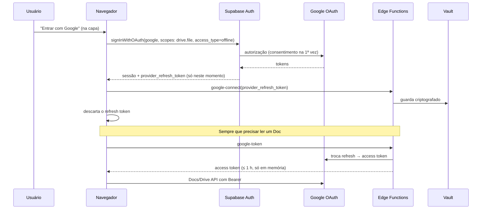

# 08 — Google (login, Docs e Drive)

## Objetivos
1. **Entrar com Google**: único método de login, restrito aos e-mails autorizados ([ADR-0013](adr/0013-login-google-e-acesso-fechado.md)).
2. **Google Docs como o texto do site**: um Doc vinculado a um mundo, entidade ou evento é **exibido, pesquisado e navegado dentro do app** como se fosse texto nativo. O Doc continua no Google Drive do usuário e é **a fonte da verdade**: o app guarda só a referência e um cache.
3. **Vincular** outros arquivos do Drive (imagens, PDFs) a entidades e eventos.
4. **Guardar imagens no Drive** do usuário, como opção (o padrão é o Storage do Supabase).

Decisão: [ADR-0008](adr/0008-google-docs-como-fonte-do-texto.md).

## Princípios
- **Um único escopo de dados: `https://www.googleapis.com/auth/drive.file`.** Ele dá acesso apenas aos arquivos que o usuário escolhe no Picker ou que o app cria, e é aceito tanto pela **Drive API** quanto pela **Docs API** (`documents.get` e `documents.batchUpdate`). Não pedimos `drive`, `drive.readonly` nem `documents`.
- **O Doc é a fonte da verdade.** O app nunca sobrescreve um Doc inteiro e nunca guarda cópia do texto no banco sem o usuário pedir (busca no servidor é opcional).
- **Nenhum HTML do Google é injetado na página.** O Doc é lido como **JSON estrutural** e convertido para nós do Tiptap (esquema fechado), o que elimina a classe de XSS por HTML externo.
- **Tokens fora do navegador quando possível.** Com Docs como texto principal, o acesso precisa existir em toda sessão sem pop-ups, por isso o *refresh token* fica no servidor, criptografado.

## Modos de texto
Cada **mundo**, **entidade** e **evento** tem um *texto principal* com uma de duas origens:

| Origem | Onde mora | Onde se edita | Bom para |
|--------|-----------|---------------|----------|
| **Nativo** | banco (JSON do Tiptap) | no app | notas curtas, fichas, rascunhos rápidos |
| **Google Doc** | Drive do usuário | Google Docs (MVP); edição leve no app (Fase 5) | capítulos, bíblia do mundo, textos longos já escritos no Docs |

Além disso, a aba **História** (painel Explorar) lista os **Docs vinculados ao mundo** (`purpose = 'chapter'`), em ordem arrastável: manuscritos, capítulos, cronologias.

Ações disponíveis na ficha:
- **Vincular Doc existente**: abre o Picker filtrado para Google Docs.
- **Criar Doc a partir desta ficha**: `files.create` (`application/vnd.google-apps.document`) dentro da pasta `Worldbuilder's Dream/<nome do mundo>` no Drive do usuário, já com o texto nativo convertido. O Doc passa a ser o texto principal.
- **Trazer para o app**: converte o Doc em texto nativo (cópia única, sem sincronia) e desfaz o vínculo.

## Leitura e renderização
1. `documents.get(documentId, includeTabsContent=true)` com o token do usuário.
2. Conversor **`google-doc-to-tiptap`** (TS puro em `domain/gdocs/`, com testes) transforma o JSON em documento Tiptap somente-leitura:
   - suportado: títulos, parágrafos, negrito/itálico/sublinhado/tachado, listas, links (com validação de protocolo), tabelas simples, notas de rodapé, imagens inline e **abas** do Docs (cada aba vira uma seção);
   - não suportado (aviso "abra no Google Docs para ver"): desenhos, equações, comentários, sugestões pendentes.
3. Imagens inline: o `contentUri` do Docs é temporário, então a imagem é baixada e guardada no cache.
4. **Cache** em IndexedDB por `documentId + revisionId`: o texto abre instantaneamente pelo cache e é revalidado em segundo plano. A leitura funciona offline.

### Texto "utilizável", não só visível
Sobre o texto renderizado, o app adiciona camadas que **não alteram o Doc**:
- **Nomes de entidades viram links**: correspondência por nome e apelidos (`entities.attributes.aliases`), sem diferenciar maiúsculas e acentos. Clicar abre a ficha; com `Alt`, foca o token no mapa.
- **Datas viram âncoras de tempo**: títulos ou trechos com data reconhecível pelo calendário do mundo (ex.: "12 de Geada de 312 EC") ganham um botão que move a linha do tempo para aquele instante.
- **Sumário lateral** com os títulos do Doc, e busca dentro do texto.
- **Citar trecho em evento**: selecionar texto → "Anexar ao evento" guarda o trecho e o `revisionId` no evento.
- **"Aparições"** na ficha de cada entidade: lista os Docs e parágrafos em que ela é citada (calculado a partir do cache).

### Busca global
Por padrão, o texto dos Docs em cache é indexado **no navegador** (MiniSearch), junto com entidades e eventos. Opcionalmente (opt-in nas configurações), uma cópia do texto vai para `external_links.search_text` para busca no servidor e entre dispositivos.

## Edição
| Fase | Como funciona |
|------|---------------|
| **MVP (Fase 3)** | Botão **Editar no Google Docs** abre o Doc em nova aba/janela. Quando o usuário volta ao app (evento `visibilitychange`/foco) ou a cada 30 s com o painel aberto, o app consulta só o `revisionId` (`documents.get` com `fields=revisionId`) e, se mudou, recarrega e re-renderiza. |
| **Fase 5 (evolução)** | Edições **leves** dentro do app via `documents.batchUpdate` com `writeControl.requiredRevisionId` (se o Doc mudou no meio, a edição é recusada e o app recarrega): acrescentar parágrafo, editar um parágrafo, inserir título com data. |
| **Não recomendado** | Editor rico completo sincronizado com o Docs (o modelo por índices torna isso frágil e arrisca corromper a formatação) e o editor do Google Docs em `iframe` (cookies de terceiros bloqueados, política de frames, UX imprevisível). |

## Autenticação e tokens
### Fluxo

- O hook *before user created* recusa e-mails fora da lista de acesso antes de criar a conta (`docs/07`). Convidados entram na lista ao aceitar o convite, e o login usa `login_hint` com o e-mail convidado.
- Login com `signInWithOAuth({ provider: 'google', options: { scopes: 'https://www.googleapis.com/auth/drive.file', queryParams: { access_type: 'offline', prompt: 'consent' } } })`. O `prompt: 'consent'` é necessário só quando não houver refresh token guardado.
- O Supabase **não renova** o token do Google: a Edge Function `google-token` faz isso com o segredo OAuth do cliente, guardado em Supabase Secrets.
- **Desconectar Google** (Configurações → Integrações): `google-disconnect` revoga no Google e apaga do Vault.

## Configuração no Google Cloud
1. Projeto `wbdream`; habilitar **Google Drive API**, **Google Docs API** e **Google Picker API**.
2. **Tela de consentimento OAuth**: tipo externo; escopos `openid`, `email`, `profile`, `drive.file`.
3. **Publicar o app ("Em produção")**: com o status **Teste**, os refresh tokens **expiram em 7 dias**, o que obrigaria a reconectar toda semana. O `drive.file` é classificado como escopo não sensível. Antes de publicar, confira no console se o projeto pede alguma verificação; logotipo personalizado pode exigir verificação de marca, então para uso pessoal publique sem logo.
4. **Credencial OAuth (Aplicativo Web)**: origens `http://localhost:4200` e `https://<dominio>`; redirecionamento `https://<projeto>.supabase.co/auth/v1/callback`.
5. **Chave de API** para o Picker: restrita aos *HTTP referrers* do app e só à Picker API.

## Implementação no front
```
core/google/
├── google-script-loader.ts   # carrega o Picker sob demanda, uma vez
├── google-token.service.ts   # pede/renova access token à Edge Function; signal accessToken + expiresAt
├── google-picker.service.ts  # abre o Picker (Docs, imagens, upload) e devolve os arquivos escolhidos
├── google-docs.service.ts    # documents.get, revisionId, batchUpdate (Fase 5)
└── google-drive.service.ts   # files.get, files.create, download de mídia
domain/gdocs/
├── google-doc-to-tiptap.ts   # conversor puro (com testes de snapshot)
├── entity-linker.ts          # detecta nomes/apelidos e gera marcas de link
└── date-anchors.ts           # detecta datas do calendário do mundo
```
- Picker: `setAppId(<número do projeto>)` é obrigatório para que o `drive.file` conceda acesso ao arquivo escolhido. Multi-seleção habilitada; visualizações `DOCUMENTS`, `DOCS_IMAGES` e upload.
- Erros 401 do Google → pedir novo token uma vez; 403/404 → o arquivo foi apagado ou desvinculado: a ficha mostra "Doc indisponível", com opções de revincular ou desvincular.

## Imagens no Drive (mapas e retratos)
- URLs "públicas" do Drive **não** servem como `src` nem como textura WebGL (redirecionamentos, CORS, cotas).
- Fluxo: `files.get?alt=media` com `Authorization: Bearer` → `Blob` → `createImageBitmap` → textura Pixi / `URL.createObjectURL`.
- Cache em IndexedDB (chave `fileId + modifiedTime`).
- Por padrão, imagens importadas vão para o **Storage do Supabase** ([ADR-0007](adr/0007-armazenamento-de-imagens.md)): é mais simples de exibir e os convidados veem sem precisar de acesso no Drive. Em Configurações, o usuário pode escolher guardar novas imagens na pasta do mundo no Drive (`files.create`).

## Dois usuários e o acesso aos Docs
O `drive.file` concede acesso **por usuário e por arquivo**. Se o usuário A vincula um Doc, o usuário B só consegue lê-lo pelo app se:
1. o Doc estiver **compartilhado** com B no Google Drive; **e**
2. B **abrir esse Doc uma vez pelo Picker** dentro do app (o app mostra "Conceder acesso a este Doc" quando receber 403/404).

Recomendação: manter os Docs de um mundo numa pasta compartilhada entre as pessoas do mundo e oferecer um botão "Conceder acesso aos Docs deste mundo" que abre o Picker já nessa pasta.

## Segurança e privacidade
- Nunca registrar tokens Google em logs, Sentry ou analytics.
- O banco guarda metadados (`external_id`, `name`, `mime_type`, `web_view_link`, `revision_id`) e, só com opt-in, `search_text`.
- Conteúdo de Docs em cache fica no IndexedDB do navegador e é apagado no logout ("Sair e limpar dados deste dispositivo").
- Seguir a **Google API Services User Data Policy** (inclusive *Limited Use*).
- CSP precisa permitir: `script-src https://apis.google.com` e `frame-src https://docs.google.com` (Picker); `connect-src https://www.googleapis.com https://docs.googleapis.com`; `img-src https://*.googleusercontent.com`. O login passa pelo Supabase (redirecionamento), então não há script do Google Identity Services. Ver `docs/09`.
