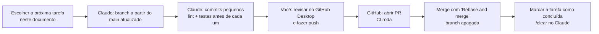

# 12 — Fluxo de trabalho com Git e plano de branches

## Ferramentas
| Ferramenta | Papel |
|------------|-------|
| **Cursor** | Editor (fork do VS Code) |
| **Extensão Claude Code** no Cursor | Escreve o código, lê a documentação, cria branches e faz commits **locais** |
| **GitHub Desktop** | Revisar diferenças, enviar (push) e acompanhar o histórico de forma visual |
| **GitHub** (site) | Pull requests, CI, merge |
| **Git** instalado no sistema | Necessário para a extensão usar `git` no terminal (no Windows, instale o *Git for Windows*; o Git interno do GitHub Desktop não fica disponível no terminal) |

O Claude Code lê automaticamente o `CLAUDE.md` da raiz, que importa o `AGENTS.md`.

## Começar o projeto (uma vez)
1. **Instalar**: Git (no Windows, *Git for Windows*), Node.js LTS, pnpm (`corepack enable` ou `npm i -g pnpm`), Cursor, GitHub Desktop. Docker e Supabase CLI só na Fase 2.
2. **Criar o repositório no GitHub Desktop**: *File › New repository*, nome `worldbuilders-dream`, **sem** README (desmarcado), *Git ignore*: **Node**, *License*: nenhuma.
3. **Copiar a documentação** para a pasta do repositório **mantendo a estrutura**:
   ```
   worldbuilders-dream/
   ├── .gitignore        (criado pelo GitHub Desktop)
   ├── README.md
   ├── AGENTS.md
   ├── CLAUDE.md
   └── docs/
       ├── 01-produto.md … 12-git-e-branches.md
       ├── adr/
       └── assets/referencias/
   ```
4. **Primeiro commit, direto no `main`** (única exceção à regra): no GitHub Desktop, resumo `0001 docs: add project documentation and agent instructions` (digite o número à mão; o hook ainda não existe). Depois, **Publish repository** com "Keep this code private" marcado.
5. **GitHub › Settings**: deixar só *Rebase and merge* e apagar branches após o merge. As regras de proteção do `main` que exigem CI entram depois da F0-02.
6. **Abrir a pasta no Cursor**, instalar a extensão **Claude Code** e entrar com a conta Claude.
7. **Primeira tarefa** (conversa nova, de preferência em modo de planejamento com Shift+Tab):
   > Leia o CLAUDE.md e faça a tarefa F0-01 do docs/12. A pasta já tem README.md, AGENTS.md, CLAUDE.md, docs/ e .gitignore, e o commit 0001 já existe no main: gere o projeto Angular nesta mesma pasta sem sobrescrever esses arquivos (junte o .gitignore do Angular ao existente). Mostre o plano antes de editar.
8. Revisar, enviar, abrir o PR e fazer o merge como no ciclo abaixo. Depois, `/clear` e siga para a F0-02.

## Ciclo de cada tarefa


1. Em uma **nova conversa** do Claude Code, peça: *"Faça a tarefa F0-03 do docs/12"*.
2. O Claude cria a branch a partir do `main` atualizado:
   ```bash
   git switch main && git pull --ff-only && git switch -c feat/f0-03-design-tokens
   ```
3. O Claude implementa em **commits pequenos**, rodando `pnpm lint` e `pnpm test` antes de cada commit.
4. Ao terminar, o Claude lista os commits e o que testar à mão. **Ele não faz push nem merge.**
5. Você revisa no GitHub Desktop, faz **push** e clica em **Create Pull Request**.
6. Com o CI verde, faça o merge com **Rebase and merge** (mantém os commits numerados no histórico). A branch é apagada automaticamente.
7. Marque a tarefa como concluída na tabela deste documento (`[x]`) e rode `/clear` no Claude antes da próxima.

**Uma branch por vez.** Toda branch nasce do `main` atualizado e é integrada antes da próxima começar. Isso mantém o histórico linear e a numeração dos commits contínua.

## Nome das branches
```
<tipo>/<id-da-tarefa>-<descricao-curta-em-kebab-case>
```
Exemplos: `chore/f0-01-bootstrap-angular`, `feat/f1-10-tokens-drag-keyframes`, `fix/f1-08-timeline-cursor-focus`.

| Tipo | Uso |
|------|-----|
| `feat` | funcionalidade nova |
| `fix` | correção de defeito |
| `chore` | configuração, dependências, ferramentas |
| `ci` | GitHub Actions, deploy |
| `docs` | só documentação |
| `test` | só testes |
| `refactor` | reorganização sem mudar comportamento |
| `spike` | prova de conceito (o resultado vira decisão registrada em ADR) |

Correções fora do plano usam o id `hotfix`: `fix/hotfix-import-png-alpha`.

## Mensagens de commit
### Formato
```
NNNN tipo(escopo): descrição no imperativo

- o que mudou, em tópicos
- outro ponto relevante

Refs: F1-10
```
- **`NNNN`**: número **sequencial** do commit no repositório, com 4 dígitos (`0001`, `0002`, …). É **adicionado automaticamente** pelo hook `prepare-commit-msg` (abaixo); quem escreve o commit não digita o número.
- **`tipo`**: mesmos tipos das branches (exceto `spike`, que usa `feat`/`chore`/`docs` conforme o conteúdo).
- **`escopo`**: área afetada: `app`, `ui`, `design`, `book`, `map`, `timeline`, `time`, `entities`, `events`, `explorer`, `tokens`, `tools`, `data`, `gdocs`, `auth`, `db`, `functions`, `google`, `invites`, `backup`, `ci`, `deps`, `docs`.
- **Descrição**: em **inglês**, imperativo, minúsculas, sem ponto final, até 72 caracteres. Deve dizer **o que foi feito**, de forma que dê para entender o histórico sem abrir o código.
- **Corpo**: tópicos com o que mudou e, quando útil, o porquê.
- **Rodapé**: `Refs: <id da tarefa>`. O Claude Code também pode adicionar a linha `Co-Authored-By`.

### Exemplos
```
0001 chore(app): bootstrap angular 22 workspace with pnpm and zoneless config
0002 chore(app): add eslint, prettier, stylelint and layer boundary rules
0003 chore(app): add lefthook with commit numbering and commitlint
0004 ci: add lint, test and build workflow
0015 feat(design): add leather, parchment and gold color tokens
0016 feat(design): self-host cinzel, eb garamond, inter and jetbrains mono
0042 feat(map): convert dropped images to webp in a web worker
0043 feat(map): downscale images larger than 8192px with a notice
0044 test(map): cover image import validation and downscaling
0087 fix(timeline): keep cursor focus after keyboard step
```

### O que é um bom commit
- **Um assunto por commit** (não misturar refatoração com funcionalidade).
- **Cada commit compila e passa nos testes**: dá para voltar a qualquer ponto do histórico.
- Migração de banco, mudança de tokens de design e atualização de dependências sempre em commits **separados**.
- Nunca: commitar no `main`, `--no-verify`, `.env`/segredos, arquivos gerados de build.

### Numeração automática (hook)
`lefthook.yml`:
```yaml
prepare-commit-msg:
  commands:
    number:
      run: sh scripts/git/number-commit.sh {1} {2}
commit-msg:
  commands:
    lint:
      run: pnpm commitlint --edit {1}
```

`scripts/git/number-commit.sh`:
```sh
#!/bin/sh
# Prefixa a mensagem com o número sequencial do commit: 0001, 0002, ...
MSG_FILE="$1"
SOURCE="$2"
case "$SOURCE" in merge|squash) exit 0 ;; esac
head -n 1 "$MSG_FILE" | grep -Eq '^[0-9]{4} ' && exit 0      # já numerado (ex.: --amend)
COUNT=$(git rev-list --count HEAD 2>/dev/null || echo 0)
N=$((COUNT + 1))
{ printf '%04d ' "$N"; cat "$MSG_FILE"; } > "$MSG_FILE.tmp" && mv "$MSG_FILE.tmp" "$MSG_FILE"
```
O número é "quantidade de commits no histórico + 1". Como cada branch nasce do `main` atualizado e entra com *rebase and merge*, a sequência no `main` fica contínua.

`commitlint.config.mjs`:
```js
export default {
  extends: ['@commitlint/config-conventional'],
  parserPreset: {
    parserOpts: {
      headerPattern: /^\d{4} (\w+)(?:\(([\w-]+)\))?!?: (.+)$/,
      headerCorrespondence: ['type', 'scope', 'subject'],
    },
  },
  rules: {
    'header-max-length': [2, 'always', 90],
    'type-enum': [2, 'always', ['feat', 'fix', 'chore', 'ci', 'docs', 'test', 'refactor', 'perf', 'style']],
    'scope-enum': [1, 'always', ['app', 'ui', 'design', 'book', 'map', 'timeline', 'time', 'entities', 'events',
      'explorer', 'tokens', 'tools', 'data', 'gdocs', 'auth', 'db', 'functions', 'google', 'invites', 'backup',
      'ci', 'deps', 'docs']],
  },
};
```

**Se o `main` mudou enquanto uma branch estava aberta** (não deveria, trabalhando uma branch por vez): peça ao Claude para fazer *rebase* da branch no `main` e **renumerar** os commits dela antes do push.

## Configuração do GitHub (uma vez)
- *Settings › General › Pull Requests*: deixe marcado **só** "Allow rebase merging"; ative "Automatically delete head branches".
- *Settings › Rules › Rulesets* (para `main`): exigir pull request, exigir o CI verde, exigir branch atualizada antes do merge, bloquear *force push* e exclusão.
- Arquivo `.github/pull_request_template.md`:
  ```markdown
  ## Tarefa
  F?-??: <título>

  ## O que foi feito
  -

  ## Como testar
  -

  ## Checklist
  - [ ] Lint e testes verdes
  - [ ] Documentação atualizada (se o comportamento mudou)
  - [ ] Sem segredos ou dados reais no commit
  ```
- **Tags** nos marcos: `v0.1.0-demo` (fim da Fase 1), `v0.2.0` (Fase 2), `v0.3.0` (Fase 3), `v1.0.0` (lançamento).

---

## Plano de branches
Cada linha é **uma branch**. A coluna "Ler" diz quais documentos o Claude precisa abrir: só esses, para economizar contexto.

### Fase 0 — Fundação do front
| ✓ | ID | Branch | Entrega | Ler |
|---|----|--------|---------|-----|
| [x] | F0-01 | `chore/f0-01-bootstrap-angular` | Workspace Angular 22 (pnpm, zoneless, TS strict, aliases, pastas do `docs/03`), ESLint/Prettier/Stylelint com fronteiras de camadas, Vitest, Playwright, lefthook + numeração + commitlint, `CLAUDE.md`/`AGENTS.md` | 03, 04, 12 |
| [x] | F0-02 | `ci/f0-02-ci-workflow` | Workflow de CI (lint, typecheck, testes, build, budgets, guarda de `dataSource`, e2e + axe), template de PR. Sem demo publicada: as prévias ao cliente são vídeos de tela | 03, 09, 12 |
| [x] | F0-03 | `feat/f0-03-design-tokens` | Paleta, tokens `--wd-*`, `@theme` do Tailwind, fontes auto-hospedadas, texturas, classes `.wd-panel`/`.wd-page` | 05 |
| [x] | F0-04 | `feat/f0-04-ui-base` | `shared/ui`: botão, ícone-botão, tooltip, diálogo, toast; página interna `/dev` | 04, 05 |
| [x] | F0-05 | `feat/f0-05-domain-core` | `domain/`: modelos (iguais ao `docs/07`), portas, calendário e interpolação com testes | 06, 07 |
| [x] | F0-06 | `feat/f0-06-local-data` | `data-access/local` (IndexedDB), `FakeAuthService`, `provideLocalDataAccess`, selo de modo demonstração | 04, 10 |
| [ ] | F0-07 | `spike/f0-07-book-poc` | Prova de conceito: capa → abertura → virada de página; medir fps; registrar a decisão no ADR-0011 | 05, ADR-0011 |
| [ ] | F0-08 | `spike/f0-08-map-poc` | Prova de conceito: PixiJS v8 + pixi-viewport, 500 tokens, imagem 8192 px; medir fps | 06, ADR-0004 |
| [ ] | F0-09 | `feat/f0-09-book-shell` | `BookShell`, capa (login simulado), biblioteca vazia, criar mundo → shell do mapa. **Marco da Fase 0** | 04, 05 |

### Fase 1 — Front completo em modo local
| ✓ | ID | Branch | Entrega | Ler |
|---|----|--------|---------|-----|
| [ ] | F1-01 | `feat/f1-01-map-import` | Área de importação (arrastar/soltar, colar, escolher arquivo), worker WebP, redução a 8192 px, criar mapa | 05, 06 §0 |
| [ ] | F1-02 | `feat/f1-02-map-engine` | Fachada `MapEngine`, camadas, pan/zoom, enquadrar, câmera salva | 06 §1 |
| [ ] | F1-03 | `feat/f1-03-map-scale-tree` | Escala do mapa, árvore de mapas, seletor no título, links entre mapas | 06 §1, §8 |
| [ ] | F1-04 | `feat/f1-04-vtt-shell` | Barras flutuantes (recolher, redimensionar, preferências), atalhos | 04, 05 |
| [ ] | F1-05 | `feat/f1-05-entities` | CRUD de entidades, ficha com Tiptap, retratos, apelidos, menções | 04, 07 |
| [ ] | F1-06 | `feat/f1-06-explorer` | Painel Explorar (abas, lista virtual, arrastável), busca com MiniSearch, paleta `Ctrl+K` | 04, 05 |
| [ ] | F1-07 | `feat/f1-07-calendar` | Editor de calendário, `TimelineStore`, formatação de datas | 06 §2 |
| [ ] | F1-08 | `feat/f1-08-timeline-bar` | Linha do tempo (SVG, eras, cursor acessível, zoom, play, velocidade, `?t=`) | 05, 06 §7 |
| [ ] | F1-09 | `feat/f1-09-events` | CRUD de eventos, marcadores na linha do tempo e no mapa, popover | 05, 06 §4 |
| [ ] | F1-10 | `feat/f1-10-tokens-drag-keyframes` | Arrastar do Explorar para o mapa, tokens, keyframes, interpolação, lista acessível | 06 §3, §6 |
| [ ] | F1-11 | `feat/f1-11-history-trails` | Desfazer/refazer (`HistoryStore`), rastro de movimento | 04, 06 §3 |
| [ ] | F1-12 | `feat/f1-12-tools-pin-ruler` | Marcar ponto e régua | 06 §5 |
| [ ] | F1-13 | `feat/f1-13-tools-draw` | Pincel, região, rótulo, validade temporal, camadas | 06 §5 |
| [ ] | F1-14 | `feat/f1-14-book-transitions` | Transições completas/curtas/desligadas, volta à biblioteca, preferências | 04, 05 |
| [ ] | F1-15 | `feat/f1-15-motion-components` | 5 componentes animados portados (com atribuições) | 05, ADR-0003 |
| [ ] | F1-16 | `feat/f1-16-library-actions` | Renomear, duplicar, arquivar, lixeira | 01, 05 |
| [ ] | F1-17 | `feat/f1-17-world-export-import` | Exportar/importar mundo em JSON (formato do `export-world`) | 02, 07 |
| [ ] | F1-18 | `feat/f1-18-gdocs-renderer` | Conversor Google Doc → Tiptap, nomes e datas como links, com fixtures | 08 |
| [ ] | F1-19 | `test/f1-19-demo-e2e` | Jornadas e2e 1 e 2, axe, medição dos RNF. **Marco: demo para o cliente** (tag `v0.1.0-demo`) | 01, 03 |

### Fase 2 — Back-end e banco
| ✓ | ID | Branch | Entrega | Ler |
|---|----|--------|---------|-----|
| [ ] | F2-01 | `feat/f2-01-supabase-schema` | `supabase init`, migrações do `docs/07`, RLS, pgTAP, tipos gerados | 07 |
| [ ] | F2-02 | `feat/f2-02-auth-allowlist` | Lista de acesso, administrador, hook, login real com Google | 07, 08, 09 |
| [ ] | F2-03 | `feat/f2-03-supabase-adapters` | `data-access/supabase` implementando as portas; RPCs | 02, 07 |
| [ ] | F2-04 | `feat/f2-04-storage-assets` | Storage, URLs assinadas, `process-asset` | 02, 09 |
| [ ] | F2-05 | `feat/f2-05-import-demo-data` | Importar JSON da demo para o banco | 02, 07 |
| [ ] | F2-06 | `ci/f2-06-daily-backup` | `backup.yml`, teste de restauração documentado | 09, 11 §9 |
| [ ] | F2-07 | `ci/f2-07-production-deploy` | Domínio, CSP de produção, migrações com aprovação manual (tag `v0.2.0`) | 03, 09 |

### Fase 3 — Integrações Google e convites
| ✓ | ID | Branch | Entrega | Ler |
|---|----|--------|---------|-----|
| [ ] | F3-01 | `feat/f3-01-google-token` | `google-connect`, `google-token`, `google-disconnect` | 08, 09 |
| [ ] | F3-02 | `feat/f3-02-picker-links` | Picker e vínculos (`external_links`) | 08 |
| [ ] | F3-03 | `feat/f3-03-docs-as-text` | Doc como texto principal, cache por revisão, "Editar no Google Docs" | 08 |
| [ ] | F3-04 | `feat/f3-04-history-tab` | Aba História, criar Doc a partir da ficha, aparições | 05, 08 |
| [ ] | F3-05 | `feat/f3-05-drive-images` | Imagens no Drive (opção) | 08, ADR-0007 |
| [ ] | F3-06 | `feat/f3-06-invites` | Convites (Resend, capa em modo convite, Configurações › Pessoas) | 02, 04, 05, 07 |
| [ ] | F3-07 | `feat/f3-07-members-revoke` | Membros por mundo, revogar acesso | 02, 07, 09 |
| [ ] | F3-08 | `test/f3-08-invite-e2e` | Jornada e2e 3 (tag `v0.3.0`) | 03 |

### Fase 4 — Acabamento e lançamento
| ✓ | ID | Branch | Entrega | Ler |
|---|----|--------|---------|-----|
| [ ] | F4-01 | `feat/f4-01-cover-art` | Arte final da capa em camadas | 05 |
| [ ] | F4-02 | `refactor/f4-02-a11y-perf` | Revisão de acessibilidade e desempenho | 01, 04 |
| [ ] | F4-03 | `feat/f4-03-delete-account` | Excluir conta | 02, 09 |
| [ ] | F4-04 | `chore/f4-04-release` | Checklist de release, tag `v1.0.0` | 09 |

Tarefas novas entram nesta tabela (com o próximo id da fase) antes de começar.

---

## Usando o Claude Code com economia
O consumo do Claude Code depende do **tamanho do contexto** de cada conversa. Hábitos que mais economizam:
1. **Uma conversa por branch.** Ao terminar a tarefa, `/clear` (custa zero). Se precisar voltar depois, use `/rename` antes e `/resume` depois.
2. **Pedidos específicos**: "faça a F1-12" (a tarefa já diz o que ler) em vez de "melhore o mapa".
3. **Ler só os documentos da coluna "Ler"**: o `CLAUDE.md` não importa a pasta `docs/` inteira de propósito.
4. **Modo de planejamento** (Shift+Tab) em tarefas grandes: o Claude propõe o plano antes de editar, evitando retrabalho.
5. **Interromper cedo** (Esc) quando o caminho estiver errado; `/rewind` volta a um ponto anterior.
6. **Modelo adequado** (`/model`): Sonnet para a maioria das tarefas; Opus para as provas de conceito e decisões de arquitetura.
7. **`/usage`** de vez em quando: mostra o consumo e recomendações.
8. **`CLAUDE.md` curto** (menos de 200 linhas): ele é carregado em toda mensagem.
